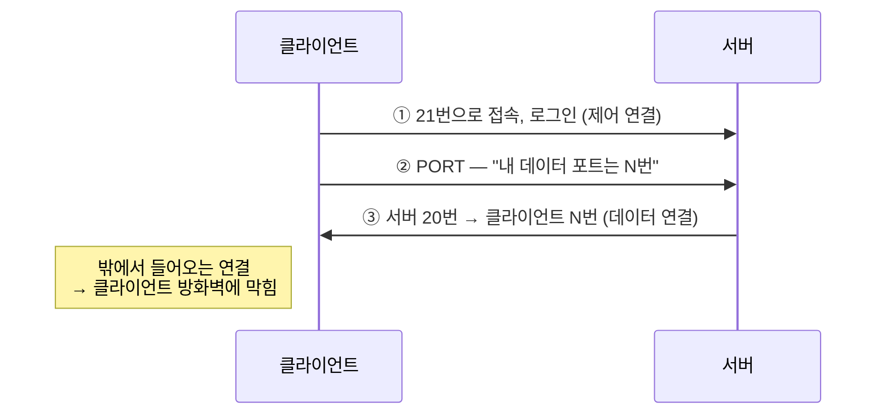
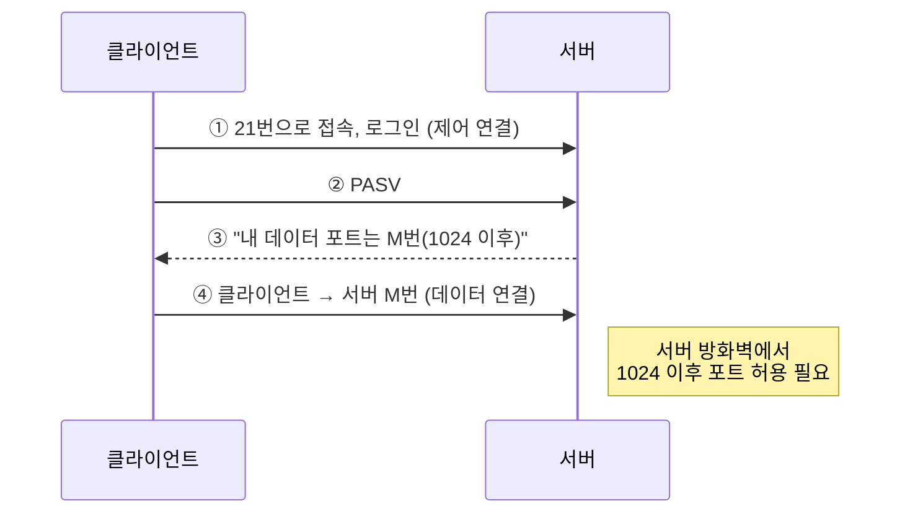

## 0. 실습 환경

| 장비 | IP | 역할 |
|---|---|---|
| Kali | **192.168.0.10** | FTP 클라이언트 |
| Ubuntu | **192.168.0.30** | FTP 서버(vsftpd) |

> 코드 블록 첫 줄의 `# === Ubuntu ===` / `# === Kali ===` 를 보고 **어느 VM에서 칠지** 확인한 뒤 붙여 넣습니다.
>
> 명령과 예상 화면은 **Ubuntu 24.04.4 LTS(vsftpd 3.0.5)** 와 **Kali Rolling** 에서 실행해 확인했습니다. 포트 번호처럼 실행할 때마다 바뀌는 값은 화면과 다를 수 있습니다.
{: .prompt-warning }

---

# 1. FTP 개념

## 1.1 FTP와 두 개의 연결

### [이론]

**FTP(File Transfer Protocol)** 는 클라이언트와 서버가 **파일을 주고받기 위한 프로토콜**입니다. 특징은 **연결을 2개** 쓴다는 점입니다.

| 연결 | 포트 | 오가는 내용 |
|---|---|---|
| **제어 연결** | **TCP 21** | 로그인(아이디·비밀번호), 명령, 응답 |
| **데이터 연결** | TCP 20 또는 **1024번 이후** 포트 | 실제 파일 내용, 파일 목록 |

데이터 연결에 어떤 포트를 쓰는지는 다음 절의 **전송 모드**에 따라 달라집니다.

### [실습] (Ubuntu) vsftpd 설치와 21번 포트 확인

**vsftpd**(very secure FTP daemon)는 리눅스에서 가장 많이 쓰는 FTP 서버입니다.

```bash
# === Ubuntu ===
sudo apt update && sudo apt install -y vsftpd
sudo systemctl enable --now vsftpd
systemctl is-active vsftpd
sudo ss -tlnp | grep vsftpd
```

```
active
LISTEN 0      32                  *:21              *:*    users:(("vsftpd",pid=1041,fd=3))
```


- `active` → 서버가 동작 중입니다.
- `*:21` → **제어 연결용 21번 포트**가 열려 접속을 기다리고 있습니다.

---

## 1.2 전송 모드 — Active와 Passive

### [이론]

두 모드의 차이는 **데이터 연결을 누가 거느냐**입니다.

| 구분 | **Active 모드** (능동) | **Passive 모드** (수동) |
|---|---|---|
| 서버가 쓰는 포트 | **21, 20** | **21, 1024번 이후** |
| 데이터 연결 방향 | **서버 → 클라이언트** | **클라이언트 → 서버** |
| 데이터 포트를 알려 주는 명령 | `PORT` (클라이언트가 자기 포트를 알림) | `PASV` (서버가 자기 포트를 알림) |
| 방화벽 문제 | 클라이언트에 방화벽이 있으면 **접속 불가** | 서버 방화벽에서 1024번 이후 포트를 허용해야 함 |

**Active 모드** — 서버가 20번 포트에서 클라이언트로 접속합니다.



**Passive 모드** — 클라이언트가 서버의 1024번 이후 포트로 접속합니다.



> - FTP의 **기본(Default)은 Active 모드**입니다.
> - Active/Passive 사용 여부는 **서버가 아니라 클라이언트가 결정**합니다.
> - Passive 모드는 클라이언트가 방화벽 뒤에 있을 때 Active 모드의 문제를 **해결하기 위해 고안**되었습니다.
> - Passive 모드용 방화벽 규칙: 서버로 향하는 **목적지 21/TCP**와 **목적지 1024 이상/TCP** 를 허용합니다.
{: .prompt-tip }

---

## 1.3 FTP 명령어

### [이론]

사용자가 `ls`, `get` 같은 명령을 치면, FTP 클라이언트는 이를 **FTP 프로토콜 명령**으로 바꿔 서버에 보냅니다. 시험에는 프로토콜 명령의 기능을 묻는 문제가 자주 나옵니다.

| 프로토콜 명령 | 기능 | 사용자가 치는 명령 |
|---|---|---|
| `USER` / `PASS` | 사용자 이름 / 비밀번호 전송 | (로그인 시 자동) |
| `LIST` | 원격지 파일 목록 보기(자세히) | `ls`, `dir` |
| `NLST` | 원격지 파일 목록 보기(이름만) | `nlist` |
| `RETR` | 원격지 파일 **가져오기**(다운로드) | `get` |
| `STOR` | 원격지에 파일 **저장**(업로드) | `put` |
| `DELE` | 원격지 파일 삭제 | `delete` |
| `CWD` | 작업 디렉터리 **변경** | `cd` |
| `PWD` | 작업 디렉터리 표시 | `pwd` |
| `MKD` | 원격지 디렉터리 **생성** | `mkdir` |
| `RMD` | 원격지 디렉터리 **제거** | `rmdir` |
| `PORT` | 데이터 포트 열기(Active) | — |
| `PASV` | Passive 모드로 전환 | `passive` |
| `ABOR` | 현재 전송 중인 파일 전송 중단 | — |
| `QUIT` | 연결 종료 | `bye` |

> 헷갈리기 쉬운 짝: **`RETR` = 가져오기**, **`STOR` = 저장하기**. **`MKD` = 만들기**, **`RMD` = 지우기**, **`CWD` = 이동**.
{: .prompt-warning }

### [실습 1] (Ubuntu) 실습용 계정과 설정

```bash
# === Ubuntu ===
sudo useradd -m -s /bin/bash ftpuser
echo 'ftpuser:ftppass123' | sudo chpasswd

sudo cp -n /etc/vsftpd.conf /etc/vsftpd.conf.bak
sudo tee -a /etc/vsftpd.conf > /dev/null <<'EOF'

# ===== Lab settings (02-1) =====
# allow upload
write_enable=YES
# passive data ports (above 1024)
pasv_min_port=40000
pasv_max_port=40100
# write login/transfer log to /var/log/vsftpd.log
xferlog_enable=YES
EOF

sudo systemctl restart vsftpd && systemctl is-active vsftpd
```

| 추가한 설정 | 의미 |
|---|---|
| `write_enable=YES` | 업로드(`put`)·디렉터리 생성 허용 |
| `pasv_min_port` / `pasv_max_port` | Passive 모드 데이터 포트를 **1024번 이후의 40000~40100** 으로 제한 |
| `xferlog_enable=YES` | 로그인 성공·실패와 파일 전송 기록을 **`/var/log/vsftpd.log`** 에 남김 (02-2의 로그 확인 실습에서 사용) |

> `xferlog_enable` 은 Ubuntu 기본 설정 파일에 이미 들어 있지만, 설정 파일이 수정되어 주석 처리된 경우가 있어 명시적으로 추가합니다. 같은 항목이 두 번 있으면 아래쪽 값이 적용됩니다.
{: .prompt-info }

Ubuntu 방화벽(ufw)이 켜져 있다면 Kali에서 오는 FTP를 허용합니다. `Status: inactive` 이면 건너뜁니다.

```bash
# === Ubuntu ===
sudo ufw status
sudo ufw allow from 192.168.0.10 to any port 21 proto tcp
sudo ufw allow from 192.168.0.10 to any port 40000:40100 proto tcp
```

> 1.2절의 "Passive 모드용 방화벽 규칙(목적지 21 + 1024 이상)"을 실제로 적용한 것입니다.
{: .prompt-info }

### [실습 2] (Kali) 접속해서 FTP 명령어 확인하기

`debug` 를 켜면, 내가 친 명령이 어떤 **FTP 프로토콜 명령**으로 바뀌어 서버에 가는지 `--->` 로 보여 줍니다.

```bash
# === Kali ===
cd ~ && echo "hello ftp" > test.txt
ftp 192.168.0.30
```

아이디 `ftpuser`, 비밀번호 `ftppass123` 으로 로그인한 뒤 아래 명령을 **한 줄씩** 입력합니다.

```
debug
ls
put test.txt
get test.txt down.txt
mkdir backup
cd backup
cd ..
rmdir backup
delete test.txt
```

화면에서 `--->` 로 시작하는 줄만 보면 다음과 같습니다(중간의 응답 줄은 생략).

```
---> LIST
---> STOR test.txt
---> RETR test.txt
---> MKD backup
---> CWD backup
---> CWD ..
---> RMD backup
---> DELE test.txt
```

📷 **캡처**: `debug` 화면에서 `---> STOR`, `---> RETR` 가 보이는 부분

| 내가 친 명령 | 서버로 간 프로토콜 명령 | 응답 |
|---|---|---|
| `ls` | `LIST` | `226 Directory send OK.` |
| `put test.txt` | `STOR test.txt` | `226 Transfer complete.` |
| `get test.txt down.txt` | `RETR test.txt` | `226 Transfer complete.` |
| `mkdir backup` | `MKD backup` | `257 "/home/ftpuser/backup" created` |
| `cd backup` | `CWD backup` | `250 Directory successfully changed.` |
| `rmdir backup` | `RMD backup` | `250 Remove directory operation successful.` |
| `delete test.txt` | `DELE test.txt` | `250 Delete operation successful.` |

> 1.3절의 명령어 표가 실제로 이렇게 오간다는 것을 확인했습니다. `put`/`get` 앞에 `EPSV` 같은 줄이 함께 보이는데, 이것은 다음 실습에서 다룹니다.
{: .prompt-tip }

### [실습 3] (Kali) Passive와 Active를 바꿔 보기

접속한 상태 그대로 이어서 입력합니다. `epsv4 off` 는 시험에 나오는 옛 형식 명령(`PASV`/`PORT`)이 보이게 하는 설정입니다.

```
epsv4 off
ls
passive
ls
passive
bye
```

```
EPSV/EPRT on IPv4 off.
---> PASV
227 Entering Passive Mode (192,168,0,30,156,94).
---> LIST
Passive mode: off; fallback to active mode: off.
---> PORT 192,168,0,10,191,123
200 PORT command successful. Consider using PASV.
---> LIST
Passive mode: on; fallback to active mode: on.
```


| 화면                                         | 의미                                                     |
| ------------------------------------------ | ------------------------------------------------------ |
| `---> PASV` → `227 ... (192,168,0,30,...)` | **Passive**: 서버가 **자기 주소**와 포트를 알려 줌 → 클라이언트가 서버로 접속   |
| `passive` → `Passive mode: off`            | 클라이언트가 모드를 바꿈 → **모드는 클라이언트가 결정**(1.2절 시험 포인트)         |
| `---> PORT 192,168,0,10,...`               | **Active**: 클라이언트가 **자기 주소**와 포트를 알려 줌 → 서버가 클라이언트로 접속 |

> **기억할 것**: 명령에 적힌 주소가 **서버 주소면 Passive**, **클라이언트 주소면 Active** 입니다.
>
> 참고로 Kali의 ftp 프로그램은 기본값이 Passive라서 처음에는 Passive로 접속합니다. 프로토콜 자체의 기본값(Active)과 프로그램의 기본 설정은 다를 수 있습니다.
{: .prompt-info }

---

## 1.4 TFTP — 인증 없는 간이 FTP

### [이론]

**TFTP(Trivial File Transfer Protocol)** 는 FTP를 아주 단순하게 만든 프로토콜입니다. 하드디스크가 없는 장비가 부팅할 때 필요한 파일을 받아 오거나, 네트워크 장비 설정을 백업하는 데 씁니다.

| 구분 | FTP | TFTP |
|---|---|---|
| 전송 계층·포트 | TCP 21 | **UDP 69** |
| 인증 | 아이디/비밀번호 | **없음** |
| 디렉터리 목록 | 있음 | 없음 |

| 메시지                     | 기능                    | 보내는 쪽        |
| ----------------------- | --------------------- | ------------ |
| **RRQ** (Read Request)  | 서버에서 파일을 **읽기** 위한 요청 | 클라이언트        |
| **WRQ** (Write Request) | 서버에 파일을 **쓰기** 위한 요청  | 클라이언트        |
| **DATA**                | 데이터 블록 전송             | 클라이언트, 서버 모두 |
| **ACK**                 | 데이터 블록을 받았다는 확인       | 클라이언트, 서버 모두 |
| **ERROR**               | 연결 실패나 전송 중 문제 알림     | 클라이언트, 서버 모두 |

> TFTP는 **인증 절차가 없어** 누구나 파일을 가져갈 수 있으므로 보안에 매우 취약합니다. 공격 유형과 대책은 02-2에서 다룹니다.
{: .prompt-warning }

---

# 2. FTP 서비스 운영

## 2.1 ftpusers — FTP 접속 거부 계정

### [이론]

**`/etc/ftpusers`** 는 **FTP 로그인을 거부할 계정**을 적어 두는 파일입니다. 여기에 적힌 계정은 비밀번호가 맞아도 FTP로 접속할 수 없습니다.

| 항목 | 내용 |
|---|---|
| 성격 | **접근 거부** 명단 (허용 명단이 아님) |
| 등록 대상 | `root`, `daemon`, `bin`, `lp`, `guest` 등 **시스템·관리자 계정** |
| 파일 소유자 | **root** |
| 파일 권한 | **640 이하** (일반 사용자가 수정하지 못하게) |

> 관리자 계정이 FTP로 로그인되면, FTP는 비밀번호를 암호화하지 않으므로(02-2) 관리자 비밀번호가 노출될 수 있습니다. 그래서 root는 반드시 ftpusers에 둡니다.
{: .prompt-info }

### [실습] (Ubuntu) ftpusers 확인과 권한 설정

```bash
# === Ubuntu ===
grep -v '^#' /etc/ftpusers | grep -v '^$'
ls -l /etc/ftpusers
```

```
root
daemon
bin
sys
sync
games
man
lp
mail
news
uucp
nobody
-rw-r--r-- 1 root root 132 Feb 24  2022 /etc/ftpusers
```

- `root` 를 비롯한 시스템 계정이 이미 등록되어 있습니다.
- 소유자는 `root` 이지만, 권한이 **644**(`rw-r--r--`)로 기준(640 이하)보다 넓습니다. 권한을 줄입니다.

```bash
# === Ubuntu ===
sudo chmod 640 /etc/ftpusers
ls -l /etc/ftpusers
```

```
-rw-r----- 1 root root 132 Feb 24  2022 /etc/ftpusers
```


### [확인] (Kali) root 로그인이 거부되는가

```bash
# === Kali ===
ftp 192.168.0.30
```

```
Name (192.168.0.30:kali): root
331 Please specify the password.
Password:
530 Login incorrect.
ftp: Login failed
ftp> bye
221 Goodbye.
```

비밀번호를 무엇으로 넣어도 `530 Login incorrect.` 로 거부됩니다.


---

## 2.2 익명 FTP(Anonymous FTP) 관리

### [이론]

**익명 FTP** 는 아이디 없이 `anonymous` 로 누구나 접속하게 하는 방식입니다. 인증을 거치지 않으므로 보안상 매우 위험합니다.

| 원칙 | 내용 |
|---|---|
| **사용 금지** | 꼭 필요한 경우가 아니면 서비스를 사용하지 않는다 |
| **쓰기 권한 금지** | 익명 사용자에게 쓰기 권한을 주면 악성 파일 업로드에 악용된다 |
| 디렉터리 관리 | 써야 한다면 익명 사용자의 루트 디렉터리와 **`bin`, `etc`, `pub`** 디렉터리의 **소유자와 권한**을 관리한다 |
| 계정 관리 | 써야 한다면 익명용 `passwd` 파일에서 불필요한 항목을 제거한다 |
| 중요 정보 | 익명 사용자가 내려받을 수 있는 곳에 중요 정보를 두지 않는다 |

### [실습] 익명 접속이 막혀 있는지 확인

```bash
# === Ubuntu ===
grep '^anonymous_enable' /etc/vsftpd.conf
```

```
anonymous_enable=NO
```

Ubuntu의 vsftpd는 기본적으로 익명 접속을 막아 둡니다. Kali에서 확인합니다.

```bash
# === Kali ===
ftp 192.168.0.30
```

```
Name (192.168.0.30:kali): anonymous
331 Please specify the password.
Password:
530 Login incorrect.
ftp: Login failed
ftp> bye
221 Goodbye.
```

📷 **캡처**: anonymous 로그인이 530으로 거부되는 화면

---

## 2.3 접근 범위 제한과 운영 원칙

### [이론]

| 운영 원칙                 | 내용                                      | vsftpd 설정                        |
| --------------------- | --------------------------------------- | -------------------------------- |
| **접근 범위 제한(chroot)**  | 사용자를 자기 홈 디렉터리에 가두어 시스템 파일에 접근하지 못하게 한다 | `chroot_local_user=YES`          |
| **연결 시간 제한(timeout)** | 아무 작업 없이 연결된 세션을 일정 시간 후 끊는다            | `idle_session_timeout=초`         |
| 필요할 때만 활성화            | FTP가 필요 없으면 서비스를 중지한다                   | `systemctl disable --now vsftpd` |
| 중요 파일 저장 금지           | FTP 서버에 중요 문서·보안 파일을 두지 않는다             | —                                |
| 최신 버전·패치              | 서버 프로그램 자체의 취약점에 대비한다                   | `apt upgrade`                    |

#### chroot란 무엇인가

**chroot(change root)** 는 사용자가 보는 **최상위 디렉터리(`/`)를 다른 디렉터리로 바꾸는 기능**입니다.

리눅스의 모든 파일은 `/` 아래에 있습니다. `/etc`, `/home`, `/var` 모두 `/` 에서 출발합니다. chroot를 적용하면 `ftpuser` 가 로그인했을 때 서버는 `/home/ftpuser` 를 그 사용자의 `/` 로 보여 줍니다. 사용자에게는 자기 홈 디렉터리가 디스크 전체이고, 그 위로 올라갈 길이 없습니다. 그래서 `/etc` 같은 시스템 디렉터리는 **보이지도 않고 들어갈 수도 없습니다.**

건물에 비유하면, chroot가 없는 사용자는 자기 방 문을 열고 복도와 다른 층까지 돌아다닐 수 있습니다. chroot를 적용한 사용자는 **방 안이 건물 전체인 것처럼** 지내게 되어 방 밖으로 나갈 수 없습니다. 이 때문에 chroot로 가둔 공간을 **감옥(jail)** 이라고도 부릅니다.

| 사용자가 입력한 명령 | chroot 미적용 | chroot 적용 |
|---|---|---|
| 로그인 직후 `pwd` | `/home/ftpuser` | `/` (실제로는 `/home/ftpuser`) |
| `cd ..` | `/home` 으로 올라감 | 계속 `/` 에 머묾 |
| `cd /etc` | 성공 | **550** 실패 |
| `get /etc/passwd` | 서버의 계정 목록을 내려받음 | 파일이 없다고 나옴 |

**왜 필요한가.** 리눅스에서 `/etc/passwd` 처럼 "누구나 읽기" 권한이 있는 파일은 일반 사용자도 읽을 수 있습니다. chroot가 없으면 FTP 계정 하나만 가진 사람도 서버의 계정 목록, 설정 파일, 다른 사용자의 디렉터리 구조를 FTP로 둘러보고 내려받을 수 있습니다. 공격자에게는 다음 공격을 준비할 정보가 됩니다. chroot는 사용자를 **자기 홈 디렉터리 안에만** 머물게 하여 이런 정보 노출을 막습니다.

#### timeout은 무엇인가

**timeout(연결 시간 제한)** 은 로그인한 뒤 **정해진 시간 동안 아무 명령도 없으면 서버가 연결을 끊는 기능**입니다.

| 위험 | timeout이 없을 때 | timeout을 설정했을 때 |
|---|---|---|
| 자리 비움 | 로그인된 화면을 다른 사람이 이어서 사용할 수 있음 | 일정 시간 뒤 자동으로 끊김 |
| 자원 낭비 | 쓰지 않는 연결이 계속 남아 서버 자원을 차지함 | 쓰지 않는 연결이 정리됨 |

### [실습 1] (Ubuntu) chroot와 timeout 설정

```bash
# === Ubuntu ===
sudo tee -a /etc/vsftpd.conf > /dev/null <<'EOF'

# ===== Lab settings (02-1 operation) =====
# lock users in their home directory
chroot_local_user=YES
allow_writeable_chroot=YES
# disconnect idle sessions after 60 seconds (lab value)
idle_session_timeout=60
EOF

sudo systemctl restart vsftpd && systemctl is-active vsftpd
```

설정 파일 끝에 세 줄을 추가하고 vsftpd를 다시 시작했습니다. 각 줄의 의미는 다음과 같습니다.

| 설정 | 의미 |
|---|---|
| `chroot_local_user=YES` | 리눅스 계정(`ftpuser` 등)으로 로그인한 사용자를 **자기 홈 디렉터리에 가둔다** |
| `allow_writeable_chroot=YES` | 홈 디렉터리에 **쓰기 권한이 있어도** chroot를 허용한다 (아래 설명 참고) |
| `idle_session_timeout=60` | **60초** 동안 아무 명령이 없으면 연결을 끊는다 |

**`allow_writeable_chroot` 가 필요한 이유.** vsftpd는 보안을 위해 **쓰기 권한이 있는 디렉터리를 감옥의 최상위로 쓰지 않으려 합니다.** 사용자가 감옥 최상위에 파일을 마음대로 만들 수 있으면, 이를 이용해 감옥을 빠져나가는 공격이 가능하기 때문입니다. 그래서 이 줄이 없으면 `ftpuser` 로그인 시 `500 OOPS: vsftpd: refusing to run with writable root inside chroot()` 오류가 나고 접속이 끊깁니다. 이 실습에서는 홈 디렉터리에 파일을 올려야 하므로 이 검사를 끕니다.

**마지막 명령의 의미.** 설정 파일을 고친 뒤에는 서비스를 다시 시작해야 반영됩니다. `systemctl is-active vsftpd` 결과가 `active` 이면 설정에 문법 오류 없이 정상적으로 올라온 것입니다.

> 실습에서는 결과를 빨리 보려고 timeout을 60초로 정했습니다. 실제 운영에서는 300초(5분) 정도를 많이 씁니다. 또한 실제 운영에서는 `allow_writeable_chroot=YES` 대신, 홈 디렉터리 최상위는 쓰기 불가로 두고 그 아래 `upload` 같은 하위 디렉터리에만 쓰기 권한을 주는 방식을 권장합니다.
{: .prompt-info }

### [실습 2] (Kali) chroot 확인

```bash
# === Kali ===
ftp 192.168.0.30
```

`ftpuser` / `ftppass123` 으로 로그인한 뒤 입력합니다.

```
pwd
cd /etc
```

```
Remote directory: /
550 Failed to change directory.
```


| 확인 | 의미 |
|---|---|
| `pwd` 가 `/home/ftpuser` 가 아닌 **`/`** | 홈 디렉터리가 최상위처럼 보임 → 그 밖으로 나갈 수 없음 |
| `cd /etc` → **550** | 서버의 시스템 설정 디렉터리에 접근할 수 없음 |

### [실습 3] (Kali) timeout 확인

로그인한 상태에서 **아무것도 입력하지 않고 1분 이상** 기다린 뒤 `ls` 를 입력합니다.

```
ls
```

```
421 Timeout.
```


1분 동안 작업이 없어서 서버가 연결을 끊었습니다. `bye` 로 빠져나옵니다.

---

## 2.4 운영 점검표

| 번호 | 점검 항목 | 양호 기준 | 이 글에서 확인한 방법 |
|---|---|---|---|
| 1 | ftpusers | root 등 시스템 계정 등록, 소유자 root, 권한 640 이하 | 2.1 |
| 2 | 익명 FTP | 사용하지 않음(`anonymous_enable=NO`) | 2.2 |
| 3 | 접근 범위 | chroot 적용 | 2.3 실습 2 |
| 4 | 연결 시간 | timeout 설정 | 2.3 실습 3 |
| 5 | 방화벽 | 21번과 패시브 포트만, 허용한 IP만 | 1.3 실습 1 |

---

# 확인 문제

> 1. FTP 전송 모드에 대한 설명으로 옳은 것은?
>    ① 기본은 Passive이며, 모드는 서버가 결정한다
>    ② 기본은 Active이며, 모드는 클라이언트가 결정한다
>    ③ 기본은 Passive이며, 모드는 클라이언트가 결정한다
>    ④ 기본은 Active이며, 모드는 서버가 결정한다
>    
> 2. FTP 서버가 Passive 모드로 동작하려면, 방화벽에서 서버로 향하는 목적지 포트 ( ㉠ )/TCP와 ( ㉡ ) 이상/TCP를 허용해야 한다. ㉠, ㉡은?
>    
> 3. FTP 명령과 기능의 연결로 옳은 것은?
>    ① RMD: 파일 다운로드
>    ② STOR: 원격지 파일 저장
>    ③ CWD: 디렉터리 생성
>    ④ MKD: 디렉터리 목록 보기
>    
> 4. TFTP가 사용하는 전송 계층 프로토콜과 포트는?
>    
> 5. `/etc/ftpusers` 파일에 대한 설명으로 틀린 것은?
>    ① 적힌 계정은 FTP 접속이 거부된다
>    ② root 계정을 등록한다
>    ③ 접속을 허용할 계정을 등록한다
>    ④ 소유자는 root, 권한은 640 이하가 바람직하다
{: .prompt-tip }

<details>
<summary>정답 보기</summary>

1. <strong>②</strong> 기본은 Active이며, Active/Passive 사용 여부는 클라이언트가 결정한다.<br>
2. ㉠ <strong>21</strong>, ㉡ <strong>1024</strong><br>
3. <strong>②</strong> (RMD는 디렉터리 제거, CWD는 디렉터리 변경, MKD는 디렉터리 생성)<br>
4. <strong>UDP 69번</strong><br>
5. <strong>③</strong> ftpusers는 허용 명단이 아니라 <strong>거부</strong> 명단이다.

</details>

---

# 체크리스트

- [ ] (Ubuntu) vsftpd가 `active`, 21번 포트가 열려 있음
- [ ] (Kali) `debug` 로 `LIST`·`STOR`·`RETR`·`MKD`·`CWD`·`RMD`·`DELE` 를 확인
- [ ] (Kali) `PASV` 와 `PORT` 에 적힌 주소가 각각 누구 것인지 설명 가능
- [ ] (Ubuntu) `/etc/ftpusers` 권한을 640으로 변경, root 로그인 530 확인
- [ ] (Kali) anonymous 로그인 530 확인
- [ ] (Kali) chroot로 `/etc` 접근 550, timeout으로 `421 Timeout.` 확인

> 다음 글 **02-2** 에서는 FTP에 어떤 공격이 있는지 알아보고, 로그인할 때 비밀번호가 네트워크에 어떻게 흐르는지 와이어샤크로 확인한 뒤 SFTP와 비교합니다.
{: .prompt-info }
