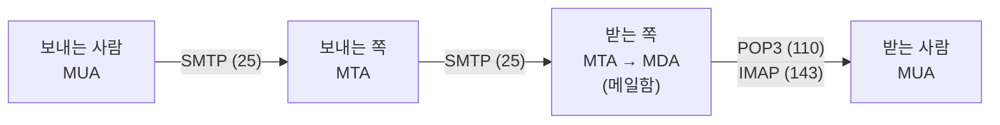
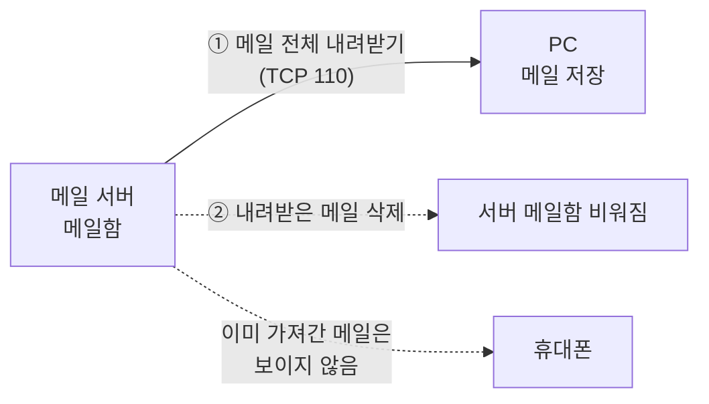
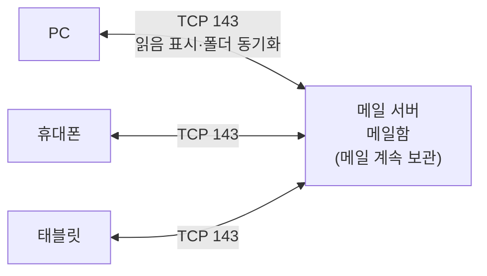

## 0. 실습 환경

| 장비 | IP | 역할 |
|---|---|---|
| Kali | **192.168.0.10** | 메일을 보내는 쪽(클라이언트), GPG 실습, Wireshark 캡처 |
| Ubuntu | **192.168.0.30** | 메일 서버(Postfix), 수신 계정 `mailuser` |

> 코드 블록 첫 줄의 `# === Ubuntu ===` / `# === Kali ===` 를 보고 **어느 VM에서 칠지** 확인한 뒤 붙여 넣습니다.
>
> 명령과 예상 화면은 **Ubuntu 24.04.4 LTS(Postfix 3.8.6)** 와 **Kali Rolling(GnuPG 2.4.9, Wireshark 4.6.6)** 에서 실행해 확인했습니다. 큐 번호, 시각, 키 지문처럼 실행할 때마다 바뀌는 값은 화면과 다를 수 있습니다.
{: .prompt-warning }

---

# 1. 이메일 개념

## 1.1 메일 시스템의 구성요소와 프로토콜

### [이론]

메일은 보내는 사람의 컴퓨터에서 받는 사람의 컴퓨터로 바로 가지 않습니다. 여러 프로그램이 역할을 나누어 **보내고, 옮기고, 넣어 두고, 꺼내 읽습니다.**

| 구성요소    | 이름                  | 역할                      | 예                         |
| ------- | ------------------- | ----------------------- | ------------------------- |
| **MUA** | Mail User Agent     | 사용자가 메일을 **쓰고 읽는** 프로그램 | Outlook, Thunderbird, 웹메일 |
| **MTA** | Mail Transfer Agent | 메일을 받아 **다른 메일 서버로 전달** | Postfix, Sendmail         |
| **MDA** | Mail Delivery Agent | 받은 메일을 수신자의 **메일함에 저장** | Postfix local, Dovecot    |




메일을 **보내고 옮길 때**와 **꺼내 읽을 때** 쓰는 프로토콜이 다르다는 점이 중요합니다.

| 프로토콜     | 포트          | 용도                     | 특징                      |
| -------- | ----------- | ---------------------- | ----------------------- |
| **SMTP** | **TCP 25**  | 메일 **송신**, 서버 간 **전달** | 명령과 본문이 **평문**          |
| **POP3** | **TCP 110** | 메일함에서 메일 **가져오기**      | 내려받으면 서버에서 지우는 방식이 기본   |
| **IMAP** | **TCP 143** | 메일함의 메일 **읽기·관리**      | 메일을 서버에 두고 여러 기기에서 같이 봄 |

#### POP3와 IMAP의 차이

POP3와 IMAP은 모두 **수신자가 메일 서버의 메일함에서 메일을 꺼내 읽을 때** 쓰는 프로토콜입니다. 두 프로토콜의 차이는 **메일을 어디에 보관하느냐**입니다.

- **POP3** 는 메일을 **내 컴퓨터로 내려받는** 방식입니다. 우체국 사서함에서 편지를 꺼내 집으로 가져오는 것과 같아서, 가져온 편지는 사서함에 남지 않습니다.
- **IMAP** 은 메일을 **서버에 둔 채로** 들여다보는 방식입니다. 편지는 사서함에 그대로 두고, 어느 기기에서 접속하든 같은 사서함을 봅니다.

**POP3** — 내려받은 메일은 서버에서 지워지고 PC 한 대에만 남습니다.



**IMAP** — 메일은 서버에 남고, 여러 기기가 같은 메일함을 함께 봅니다.



| 구분 | **POP3** | **IMAP** |
|---|---|---|
| 정식 명칭 | Post Office Protocol version 3 | Internet Message Access Protocol (현재 버전 4) |
| 포트 (평문 / 암호화) | **110** / **995**(POP3S) | **143** / **993**(IMAPS) |
| 메일 보관 위치 | **내 컴퓨터(클라이언트)** | **메일 서버** |
| 기본 동작 | 메일을 내려받은 뒤 **서버에서 삭제** (설정으로 사본을 남길 수 있음) | 메일을 **서버에 둔 채** 열람 |
| 여러 기기에서 사용 | 어렵다. PC에서 받은 메일은 휴대폰에서 보이지 않음 | 쉽다. PC·휴대폰·웹메일이 같은 메일함을 봄 |
| 읽음 표시·폴더 | 내 컴퓨터에만 반영됨 | **서버에 저장되어 모든 기기에 동기화**됨 |
| 인터넷 없이 열람 | 이미 내려받은 메일은 볼 수 있음 | 서버에 접속해야 볼 수 있음(일부 프로그램은 사본을 임시 저장) |
| 메일을 받는 방식 | 메일 전체를 한꺼번에 내려받음 | 제목·보낸 사람 같은 **헤더를 먼저** 받고, 본문은 열 때 받음 |
| 서버 저장 공간 | 적게 씀 | 많이 씀 (메일이 계속 서버에 쌓임) |
| 적합한 환경 | 기기 하나로만 메일을 보는 사용자 | 여러 기기를 쓰는 사용자, 기업 메일 |

#### 보안 측면에서 본 차이

두 방식은 **메일이 어디에 모여 있느냐**가 달라서, 위험이 생기는 곳도 다릅니다.

| 구분 | **POP3** | **IMAP** |
|---|---|---|
| 메일이 모여 있는 곳 | 사용자 PC | 메일 서버 |
| 주된 위험 | PC 분실·도난·악성코드 감염 시 **PC에 저장된 메일이 유출** | 메일 계정이 탈취되거나 서버가 침해되면 **서버에 보관된 전체 메일이 노출** |
| 서버 침해 시 피해 | 서버에는 메일이 적게 남아 있어 상대적으로 작음 | 오래된 메일까지 모두 서버에 있어 큼 |
| 대책 | PC 디스크 암호화, 백신, 내려받은 메일 백업 | 강한 비밀번호와 2단계 인증, 오래된 메일 정리, 서버 보안 강화 |

> 두 프로토콜 모두 로그인할 때 **아이디와 비밀번호를 평문으로** 보냅니다. POP3는 `USER`·`PASS` 명령, IMAP은 `LOGIN` 명령으로 보냅니다. 그래서 110·143번 포트를 그대로 쓰면 같은 네트워크의 공격자가 비밀번호를 가로챌 수 있습니다. 반드시 TLS로 암호화한 **POP3S(995)·IMAPS(993)** 를 사용하는 것이 중요합니다.
{: .prompt-warning }

> 세 프로토콜 모두 기본은 **평문**입니다. 암호화를 더한 방식은 SMTPS(465)·Submission(587, STARTTLS), POP3S(995), IMAPS(993)를 씁니다.
{: .prompt-info }

### [실습 1] (Ubuntu) Postfix 설치와 25번 포트 확인

**Postfix** 는 리눅스에서 많이 쓰는 MTA입니다. 설치 중 설정 화면이 나오면 다음과 같이 고릅니다.

| 설정 화면 | 선택 |
|---|---|
| General type of mail configuration | **Internet Site** |
| System mail name | **ubuntu.lab.local** |

> **System mail name 칸에는 메일 주소가 아니라 도메인 이름을 넣습니다.**
> - 칸에는 `ubuntu-y1` 처럼 각자의 호스트 이름이 미리 채워져 있습니다. 모두 지우고 `ubuntu.lab.local` 을 입력한 뒤 `<Ok>` 를 누릅니다.
> - `@` 를 넣으면 안 됩니다(예: `ubuntu-y1@sS` ✗). 이 값은 `mailuser@ubuntu.lab.local` 에서 **`@` 뒤쪽**이 됩니다.
> - 실제로 등록한 도메인이 없어도 됩니다. `lab.local` 은 실습실 안에서만 쓰는 임의의 이름입니다.
> - 잘못 입력했다면 `sudo dpkg-reconfigure postfix` 로 설정 화면을 다시 열어 고칠 수 있습니다.
{: .prompt-warning }

```bash
# === Ubuntu ===
sudo apt update && sudo apt install -y postfix mailutils
sudo postconf -e 'myhostname = ubuntu.lab.local'
sudo systemctl restart postfix
systemctl is-active postfix
sudo ss -tlnp | grep ':25 '
```

설치 중 위의 설정 화면 두 개가 차례로 나옵니다. 설치가 끝나면 `apt` 의 진행 메시지 끝부분이 다음과 같이 출력됩니다(설치 진행 줄 수십 개는 `...` 로 생략).

```
...
Setting up postfix (3.8.6-1ubuntu0.1) ...
...
setting myhostname: ubuntu
setting alias maps
setting alias database
setting myorigin
setting destinations: $myhostname, ubuntu.lab.local, ubuntu, localhost.localdomain, localhost
setting relayhost: 
setting mynetworks: 127.0.0.0/8 [::ffff:127.0.0.0]/104 [::1]/128
setting mailbox_size_limit: 0
setting recipient_delimiter: +
setting inet_interfaces: all
setting inet_protocols: all
...
Postfix (main.cf) is now set up with a default configuration.  If you need to 
make changes, edit /etc/postfix/main.cf (and others) as needed.  To view 
Postfix configuration values, see postconf(1).

After modifying main.cf, be sure to run 'systemctl reload postfix'.

Running newaliases
Created symlink /etc/systemd/system/multi-user.target.wants/postfix.service → /usr/lib/systemd/system/postfix.service.
...
```

`postconf -e` 와 `systemctl restart` 는 **아무것도 출력하지 않습니다.** 마지막 두 명령의 결과는 다음과 같습니다.

```
active
LISTEN 0      100           0.0.0.0:25        0.0.0.0:*    users:(("master",pid=540,fd=13))
LISTEN 0      100              [::]:25           [::]:*    users:(("master",pid=540,fd=14))
```

> `setting myhostname:` 과 `setting destinations:` 의 `ubuntu` 자리에는 각자의 Ubuntu 호스트 이름이 나옵니다. `pid=` 숫자도 실행할 때마다 다릅니다.
{: .prompt-info }

- `active` → 메일 서버가 동작 중입니다.
- `0.0.0.0:25` → **SMTP용 25번 포트**가 열려 메일을 기다리고 있습니다. Postfix의 대표 프로세스 이름은 `master` 입니다.

| 명령·옵션 | 설명 |
|---|---|
| `apt install -y postfix mailutils` | 메일 서버 Postfix와 메일 도구 모음(mailutils)을 설치. `-y` 는 "설치할까요?" 질문에 자동으로 예 |
| `postconf -e '항목 = 값'` | Postfix 설정 파일(`/etc/postfix/main.cf`)의 항목을 **수정(edit)**. 파일을 직접 열지 않고 한 줄로 고칠 수 있음 |
| `systemctl restart postfix` | Postfix를 다시 시작해 바뀐 설정을 반영 |
| `systemctl is-active postfix` | 서비스가 동작 중인지 한 단어(`active`/`inactive`)로 표시 |
| `ss -tlnp` | 열려 있는 포트 목록. `-t` TCP만, `-l` 접속을 기다리는(LISTEN) 포트만, `-n` 포트를 숫자로, `-p` 사용 중인 프로그램 이름 표시 |
| `grep ':25 '` | 출력 중 `:25 ` 가 들어 있는 줄만 골라 보여 줌 |


### [실습 2] (Ubuntu) 메일을 받을 계정과 방화벽

메일을 받을 실습용 계정 `mailuser` 를 만듭니다. 이 계정의 메일함은 **`/var/mail/mailuser`** 파일입니다.

```bash
# === Ubuntu ===
sudo useradd -m -s /bin/bash mailuser
echo 'mailuser:mailpass123' | sudo chpasswd
id mailuser
```

`useradd` 와 `chpasswd` 는 아무것도 출력하지 않고, `id` 만 결과를 보여 줍니다.

```
uid=1001(mailuser) gid=1001(mailuser) groups=1001(mailuser)
```

> `1001` 은 이미 만들어진 계정 수에 따라 달라질 수 있습니다. `mailuser` 라는 이름이 보이면 정상입니다.
{: .prompt-info }

| 명령·옵션 | 설명 |
|---|---|
| `useradd -m -s /bin/bash mailuser` | 계정 `mailuser` 생성. `-m` 홈 디렉터리를 함께 만듦, `-s /bin/bash` 로그인 셸 지정 |
| <code>echo '계정:비밀번호' &#124; chpasswd</code> | `계정:비밀번호` 형식의 입력을 받아 비밀번호를 설정 |
| `id mailuser` | 계정이 만들어졌는지 사용자 번호(uid)와 그룹으로 확인 |

Ubuntu 방화벽(ufw)이 켜져 있다면 Kali에서 오는 SMTP를 허용합니다. `Status: inactive` 이면 건너뜁니다.

```bash
# === Ubuntu ===
sudo ufw status
sudo ufw allow from 192.168.0.10 to any port 25 proto tcp
```

방화벽이 꺼져 있는(Ubuntu 기본값) 경우의 화면입니다. 규칙은 미리 등록되어, 나중에 방화벽을 켜면 바로 적용됩니다.

```
Status: inactive
Rules updated
```

방화벽이 이미 켜져 있었다면 첫 줄이 `Status: active` 와 기존 규칙 목록으로 나오고, 둘째 명령은 같은 `Rules updated` 를 출력합니다.

| 명령·옵션 | 설명 |
|---|---|
| `ufw status` | 방화벽이 켜져 있는지(`active`/`inactive`)와 규칙 목록 표시 |
| `ufw allow from 192.168.0.10` | 출발지가 Kali(192.168.0.10)인 접속을 허용 |
| `to any port 25 proto tcp` | 이 서버의 **TCP 25번** 포트로 오는 것만 허용 |

---

## 1.2 SMTP 명령어와 응답 코드

### [이론]

SMTP는 클라이언트가 **사람이 읽을 수 있는 글자 명령**을 한 줄씩 보내고, 서버가 **세 자리 숫자 응답**으로 답하는 프로토콜입니다.

| 명령               | 기능                                           |
| ---------------- | -------------------------------------------- |
| `HELO` / `EHLO`  | 인사하며 자기 이름을 알림 (`EHLO` 는 서버가 지원하는 기능 목록도 받음) |
| `MAIL FROM:<주소>` | **보내는 사람** 주소(봉투의 발신자)                       |
| `RCPT TO:<주소>`   | **받는 사람** 주소(봉투의 수신자)                        |
| `DATA`           | 이제부터 메일 내용(헤더+본문)을 보냄                        |
| `.` (마침표 한 글자 줄) | 메일 내용의 끝                                     |
| `VRFY` / `EXPN`  | 계정·메일링 목록이 있는지 확인 (보안상 막아야 함, 03-2)          |
| `QUIT`           | 연결 종료                                        |

| 응답 코드 | 의미 |
|---|---|
| `220` | 서버 준비 완료 (접속 직후 인사) |
| `250` | 요청 처리 성공 |
| `354` | 메일 내용을 보내라, `.` 으로 끝내라 |
| `221` | 연결 종료 |
| `4xx` | 일시적 실패 (나중에 다시 시도) |
| `5xx` | 영구적 실패 (거부) |

> 메일에는 **봉투**와 **편지지**가 따로 있습니다. `MAIL FROM` / `RCPT TO` 는 서버가 배달에 쓰는 **봉투 주소**이고, `DATA` 안의 `From:` / `To:` 는 사용자 화면에 보이는 **편지지 주소**입니다. 둘이 달라도 SMTP는 막지 않습니다. 이것이 발신자 위조가 가능한 이유입니다(03-2).
{: .prompt-warning }

### [실습] (Kali) SMTP 명령으로 직접 메일 보내기

`nc`(netcat)로 Ubuntu의 25번 포트에 접속해 SMTP 명령을 손으로 입력합니다.

```bash
# === Kali ===
nc -C 192.168.0.30 25
```

| 명령·옵션 | 설명 |
|---|---|
| `nc` | **netcat**. 지정한 IP·포트로 TCP 연결을 열고, 키보드로 친 글자를 그대로 상대에게 보내며 받은 글자를 화면에 보여 주는 도구. Kali에 기본 설치되어 있음 |
| `-C` | 줄을 바꿀 때 SMTP 규칙에 맞는 줄 끝(CR+LF)을 보냄. 이 옵션이 없으면 서버가 `.` 줄을 본문의 끝으로 알아듣지 못할 수 있음 |
| `192.168.0.30 25` | 접속할 서버 IP와 포트(SMTP 25번) |

접속되면 `220` 인사가 나옵니다. 아래를 **한 줄씩** 입력합니다. `DATA` 다음의 빈 줄은 **헤더와 본문을 나누는 줄**이므로 빠뜨리지 않습니다.

```
EHLO kali
MAIL FROM:<kali@kali.lab.local>
RCPT TO:<mailuser@ubuntu.lab.local>
DATA
From: kali@kali.lab.local
To: mailuser@ubuntu.lab.local
Subject: SMTP test

Hello, this mail was sent by hand.
.
QUIT
```

터미널에는 **내가 입력한 줄과 서버 응답이 번갈아** 나타납니다. 전체 화면은 다음과 같습니다.

```
220 ubuntu.lab.local ESMTP Postfix (Ubuntu)
EHLO kali
250-ubuntu.lab.local
250-PIPELINING
250-SIZE 10240000
250-VRFY
250-ETRN
250-STARTTLS
250-ENHANCEDSTATUSCODES
250-8BITMIME
250-DSN
250-SMTPUTF8
250 CHUNKING
MAIL FROM:<kali@kali.lab.local>
250 2.1.0 Ok
RCPT TO:<mailuser@ubuntu.lab.local>
250 2.1.5 Ok
DATA
354 End data with <CR><LF>.<CR><LF>
From: kali@kali.lab.local
To: mailuser@ubuntu.lab.local
Subject: SMTP test

Hello, this mail was sent by hand.
.
250 2.0.0 Ok: queued as 5B8737AB
QUIT
221 2.0.0 Bye
```

> `DATA` 다음부터 `.` 까지는 서버가 아무 응답도 하지 않습니다. 본문이 끝났다는 신호(`.`)를 받은 뒤에야 `250 ... queued as` 로 한 번에 답합니다. `queued as` 뒤의 큐 번호는 실행할 때마다 다릅니다.
{: .prompt-info }


| 내가 보낸 명령 | 서버 응답 | 의미 |
|---|---|---|
| (접속) | `220 ... ESMTP Postfix` | 메일 서버 준비 완료 |
| `EHLO kali` | `250-...` 여러 줄 | 지원 기능 목록. `VRFY`, `STARTTLS` 가 보임 |
| `MAIL FROM:` | `250 2.1.0 Ok` | 보내는 사람 접수 |
| `RCPT TO:` | `250 2.1.5 Ok` | 받는 사람 접수 |
| `DATA` | `354 End data with ...` | 내용을 보내고 `.` 으로 끝내라 |
| `.` | `250 2.0.0 Ok: queued as 5B8737AB` | 메일이 **큐(대기열)** 에 들어감 |
| `QUIT` | `221 2.0.0 Bye` | 연결 종료 |

> `QUIT` 뒤에도 프롬프트가 돌아오지 않으면 `Ctrl+C` 로 빠져나옵니다.
{: .prompt-info }

---

## 1.3 메일 헤더 읽기

### [이론]

받은 메일의 맨 위에는 **헤더**가 붙어 있습니다. 헤더는 메일이 누구에게서 어떤 길을 거쳐 왔는지 알려 주는 기록입니다.

| 헤더 | 의미 |
|---|---|
| **`Received`** | 메일이 **거쳐 온 서버** 기록. 서버를 지날 때마다 한 줄씩 **위에 추가**됨 |
| `Return-Path` | 반송 주소. `MAIL FROM` 의 값 |
| `From` | 보낸 사람 주소(화면에 보이는 값) |
| `To` | 받는 사람 주소 |
| `Reply-To` | 답장을 받을 주소 |
| `Date` | 메일을 보낸 날짜 |
| `Subject` | 메일 제목 |
| `Message-ID` | 메일마다 붙는 **고유 식별 번호** |
| `MIME-Version` | MIME 버전 |
| `Content-Type` | 메일 내용의 MIME 형태와 문자 집합 |
| `Content-Transfer-Encoding` | 메일 내용을 인코딩한 방법(Base64 등) |
| `X-Mailer` | 보낸 사람이 사용한 메일 프로그램 |

**실제 발송자의 IP를 추적할 때 보는 헤더는 `Received`** 입니다. `From` 은 보내는 사람이 마음대로 적을 수 있지만, `Received` 는 각 서버가 **접속해 온 상대의 실제 IP**를 직접 적어 넣기 때문입니다.

#### Received 헤더의 형식

```
Received: from (sending host) (real IP) by (receiving host) ... for <recipient>; (date and time)
```

`from A by B` 는 **"A가 B에게 넘겨주었다"** 는 뜻입니다.

#### 여러 줄일 때 읽는 순서 — 아래에서 위로

서버를 지날 때마다 새 `Received` 가 **맨 위에** 붙습니다. 그래서 **가장 아래 줄이 첫 번째 구간**, 가장 위 줄이 마지막 구간입니다. 예를 들어 아래 헤더를 받았다고 합시다.

```
Received: from relay.mail.example.kr (relay.mail.example.kr [10.1.1.20])
        by inbox.mail.example.kr; Tue, 6 Oct 2026 10:00:07 +0900
Received: from pc-sales (unknown [203.0.113.45])
        by relay.mail.example.kr; Tue, 6 Oct 2026 10:00:05 +0900
From: sales@example.kr
To: lee@example.kr
```

| 순서 | 읽는 줄 | 의미 |
|---|---|---|
| ① | 아래 줄 | `pc-sales [203.0.113.45]` → `relay.mail.example.kr` (10:00:05) |
| ② | 위 줄 | `relay.mail.example.kr` → `inbox.mail.example.kr` (10:00:07) |

전체 흐름: **pc-sales(203.0.113.45) → relay.mail.example.kr → inbox.mail.example.kr → lee@example.kr**

> 시각도 아래 줄이 더 이릅니다. 줄이 많아 헷갈리면 **시각이 가장 이른 줄**에서 출발해 위로 올라가며 읽습니다. 가장 아래 `Received` 의 IP가 **실제 발송지**에 가장 가까운 정보입니다.
{: .prompt-tip }

### [실습] (Ubuntu) 받은 메일의 헤더 확인

1.2절에서 보낸 메일이 `mailuser` 의 메일함에 들어왔는지 봅니다.

```bash
# === Ubuntu ===
sudo cat /var/mail/mailuser
```

> `/var/mail/mailuser` 는 `mailuser` 의 메일함 파일이며, 다른 사람의 메일을 볼 수 없도록 **본인만 읽을 수 있게** 되어 있습니다. 그래서 관리자 권한(`sudo`)으로 엽니다. `cat` 은 파일 내용을 화면에 출력하는 명령입니다.
{: .prompt-info }

```
From kali@kali.lab.local  Mon Oct 19 22:45:05 2026
Return-Path: <kali@kali.lab.local>
X-Original-To: mailuser@ubuntu.lab.local
Delivered-To: mailuser@ubuntu.lab.local
Received: from kali (unknown [192.168.0.10])
	by ubuntu.lab.local (Postfix) with ESMTP id 5B8737AB
	for <mailuser@ubuntu.lab.local>; Mon, 19 Oct 2026 22:45:02 +0900 (KST)
From: kali@kali.lab.local
To: mailuser@ubuntu.lab.local
Subject: SMTP test
Message-Id: <20261019134503.5B8737AB@ubuntu.lab.local>
Date: Mon, 19 Oct 2026 22:45:02 +0900 (KST)

Hello, this mail was sent by hand.
```

| 헤더 | 화면의 값 | 어디서 왔나 |
|---|---|---|
| `Return-Path` | `<kali@kali.lab.local>` | 내가 친 `MAIL FROM` |
| `Received` | `from kali (unknown [192.168.0.10]) by ubuntu.lab.local` | `kali` 는 내가 친 `EHLO` 이름, **`192.168.0.10` 은 서버가 직접 확인한 실제 IP** |
| `Received` 의 `id 5B8737AB` | 큐 번호 | 1.2절 `queued as 5B8737AB` 와 같음 |
| `From`, `To`, `Subject` | 내가 `DATA` 안에 적은 값 | 내가 적은 그대로 |
| `Message-Id`, `Date` | 서버가 붙인 값 | 내가 적지 않아서 서버가 채움 |

> 이 실습은 Kali에서 Ubuntu로 바로 보냈기 때문에 `Received` 가 한 줄입니다. 인터넷 메일은 보통 여러 서버를 거치므로 여러 줄이 쌓이고, 위의 이론처럼 **아래에서 위로** 읽습니다.
{: .prompt-info }

---

## 1.4 회선에서 본 메일 — Wireshark로 엿보기

### [이론]

메일은 보내는 PC에서 메일 서버까지 **스위치, 공유기, 라우터** 같은 여러 장비를 거쳐 갑니다. 이 길 위에서 오가는 패킷을 몰래 모아 내용을 보는 것을 **스니핑(sniffing, 도청)** 이라고 합니다.

SMTP(25)는 명령과 본문을 **평문**으로 보냅니다. 그래서 다음 사람들은 메일 서버를 해킹하지 않고도 **회선만 보고 메일 내용을 읽을 수 있습니다.**

| 엿볼 수 있는 사람 | 예 |
|---|---|
| 같은 네트워크의 사용자 | 같은 공용 Wi-Fi에 접속한 사람, 같은 스위치에 연결된 PC |
| 경로 위의 장비 관리자 | 공유기·라우터·회사 방화벽을 관리하는 사람, 통신사 |
| 경로 위의 장비를 장악한 공격자 | 악성코드에 감염된 공유기, 포트 미러링을 설정한 스위치 |

**Wireshark** 는 네트워크 카드를 지나가는 패킷을 모아(캡처) 프로토콜별로 풀어 보여 주는 프로그램입니다. Kali에 기본 설치되어 있습니다.

> 실습에서는 Kali가 **자기가 보내는 패킷**을 캡처합니다. 경로 위의 도청자가 보는 것도 **이와 똑같은 패킷**입니다. 다른 사람의 통신을 허락 없이 캡처하는 것은 불법(통신비밀보호법 위반)이므로 **실습망 안에서만** 합니다.
{: .prompt-danger }

### [실습 1] (Kali) Wireshark 캡처 시작

먼저 Kali의 네트워크 카드 이름을 확인하고 Wireshark를 실행합니다.

```bash
# === Kali ===
ip -br addr
wireshark &
```

```
lo               UNKNOWN        127.0.0.1/8 ::1/128 
eth0             UP             192.168.0.10/24 fe80::a00:27ff:fe12:3456/64 
```

`wireshark &` 는 터미널에 `[1] 2345` 처럼 **작업 번호와 프로세스 번호** 한 줄만 출력하고, Wireshark 창이 열립니다.

> `192.168.0.10` 이 붙은 카드(여기서는 `eth0`)를 캡처합니다. 카드 이름, `fe80::` 주소, 프로세스 번호는 VM마다 다를 수 있습니다.
{: .prompt-info }

| 명령·옵션 | 설명 |
|---|---|
| `ip -br addr` | 네트워크 카드별 IP를 한 줄씩 간단히(`-br`, brief) 표시 |
| `wireshark &` | Wireshark 실행. `&` 는 프로그램을 뒤에서 실행해 터미널을 계속 쓸 수 있게 함 |

Wireshark 첫 화면에서 다음 순서로 캡처를 시작합니다.

| 순서 | 할 일 |
|---|---|
| ① | 위쪽 **캡처 필터** 칸(`...using this filter:`)에 `tcp port 25` 입력 → SMTP 패킷만 모음 |
| ② | 인터페이스 목록에서 **`eth0`** 를 더블클릭 → 캡처 시작 |
| ③ | 캡처 화면 위쪽 **디스플레이 필터** 칸에 `smtp` 입력 후 `Enter` → SMTP 명령·응답만 표시 |

> 인터페이스 목록이 비어 있거나 권한 오류(`permission denied`)가 나오면 Wireshark를 닫고 `sudo usermod -aG wireshark kali` 를 실행한 뒤 **로그아웃했다가 다시 로그인**합니다. `wireshark` 그룹에 들어가야 일반 사용자도 패킷을 캡처할 수 있습니다.
{: .prompt-warning }

### [실습 2] (Kali) 비밀번호가 담긴 메일 보내기

직원이 동료에게 **VPN 계정과 비밀번호를 메일로 알려 주는** 상황을 흉내 냅니다. 캡처를 켜 둔 채로 1.2절과 같은 방법으로 메일을 보냅니다.

```bash
# === Kali ===
nc -C 192.168.0.30 25
```

접속되면 아래를 한 줄씩 입력합니다.

```
EHLO kali
MAIL FROM:<kali@kali.lab.local>
RCPT TO:<mailuser@ubuntu.lab.local>
DATA
From: kali@kali.lab.local
To: mailuser@ubuntu.lab.local
Subject: VPN account

VPN ID: mailuser
VPN password: Summer2026!
.
QUIT
```

터미널 전체 화면은 다음과 같습니다.

```
220 ubuntu.lab.local ESMTP Postfix (Ubuntu)
EHLO kali
250-ubuntu.lab.local
250-PIPELINING
250-SIZE 10240000
250-VRFY
250-ETRN
250-STARTTLS
250-ENHANCEDSTATUSCODES
250-8BITMIME
250-DSN
250-SMTPUTF8
250 CHUNKING
MAIL FROM:<kali@kali.lab.local>
250 2.1.0 Ok
RCPT TO:<mailuser@ubuntu.lab.local>
250 2.1.5 Ok
DATA
354 End data with <CR><LF>.<CR><LF>
From: kali@kali.lab.local
To: mailuser@ubuntu.lab.local
Subject: VPN account

VPN ID: mailuser
VPN password: Summer2026!
.
250 2.0.0 Ok: queued as AA3963731
QUIT
221 2.0.0 Bye
```

`queued as` 가 나오면 전송된 것입니다(큐 번호는 실행할 때마다 다름). 메일을 보낸 뒤 Wireshark 위쪽의 빨간 네모 버튼(**Stop**)을 눌러 캡처를 멈춥니다.

### [실습 3] (Kali) 패킷 목록에서 비밀번호 찾기

디스플레이 필터 `smtp` 를 적용한 패킷 목록의 Source·Destination·Protocol·Info 열은 다음과 같습니다(No.·Time·Length 열은 생략).

```
Source        Destination   Protocol  Info
192.168.0.30  192.168.0.10  SMTP      S: 220 ubuntu.lab.local ESMTP Postfix (Ubuntu)
192.168.0.10  192.168.0.30  SMTP      C: EHLO kali
192.168.0.30  192.168.0.10  SMTP      S: 250-ubuntu.lab.local | PIPELINING | SIZE 10240000 | VRFY | ETRN | STARTTLS | ENHANCEDSTATUSCODES | 8BITMIME | DSN | SMTPUTF8 | CHUNKING
192.168.0.10  192.168.0.30  SMTP      C: MAIL FROM:<kali@kali.lab.local>
192.168.0.30  192.168.0.10  SMTP      S: 250 2.1.0 Ok
192.168.0.10  192.168.0.30  SMTP      C: RCPT TO:<mailuser@ubuntu.lab.local>
192.168.0.30  192.168.0.10  SMTP      S: 250 2.1.5 Ok
192.168.0.10  192.168.0.30  SMTP      C: DATA
192.168.0.30  192.168.0.10  SMTP      S: 354 End data with <CR><LF>.<CR><LF>
192.168.0.10  192.168.0.30  SMTP      C: DATA fragment, 27 bytes
192.168.0.10  192.168.0.30  SMTP      C: DATA fragment, 31 bytes
192.168.0.10  192.168.0.30  SMTP      C: DATA fragment, 22 bytes
192.168.0.10  192.168.0.30  SMTP      C: DATA fragment, 2 bytes
192.168.0.10  192.168.0.30  SMTP      C: DATA fragment, 18 bytes
192.168.0.10  192.168.0.30  SMTP      C: DATA fragment, 27 bytes
192.168.0.10  192.168.0.30  SMTP/IMF  from: kali@kali.lab.local, subject: VPN account, , VPN ID: mailuser  , VPN password: Summer2026!  C: .
192.168.0.30  192.168.0.10  SMTP      S: 250 2.0.0 Ok: queued as AA3963731
192.168.0.10  192.168.0.30  SMTP      C: QUIT
192.168.0.30  192.168.0.10  SMTP      S: 221 2.0.0 Bye
```

> 화면은 Wireshark 4.6.6에서 같은 순서로 메일을 보내 확인한 결과이며, IP는 이 글의 실습 환경에 맞춰 적었습니다. 큐 번호는 실행할 때마다 다릅니다.
{: .prompt-info }

| Info 열의 표시 | 의미 |
|---|---|
| `C:` / `S:` | **C**lient(Kali)가 보낸 명령 / **S**erver(Ubuntu)가 보낸 응답 |
| `C: EHLO kali`, `C: MAIL FROM:...` | 1.2절에서 손으로 친 명령이 **글자 그대로** 보임 |
| `DATA fragment, 27 bytes` | 메일 내용의 한 조각. `nc` 는 한 줄을 칠 때마다 보내므로 줄마다 조각이 생김 (`From: kali@kali.lab.local` 25글자 + 줄 끝 2바이트 = 27) |
| `SMTP/IMF` | `.` 을 받는 순간 Wireshark가 조각을 모아 **메일 한 통(IMF, Internet Message Format)** 으로 풀어 보여 줌 |
| `VPN password: Summer2026!` | **비밀번호가 패킷 목록에 그대로 노출됨** |

이번에는 대화 전체를 한 화면으로 봅니다. 아무 SMTP 패킷이나 오른쪽 클릭 → **Follow → TCP Stream** 을 고릅니다.

```
220 ubuntu.lab.local ESMTP Postfix (Ubuntu)
EHLO kali
250-ubuntu.lab.local
250-PIPELINING
250-SIZE 10240000
250-VRFY
250-ETRN
250-STARTTLS
250-ENHANCEDSTATUSCODES
250-8BITMIME
250-DSN
250-SMTPUTF8
250 CHUNKING
MAIL FROM:<kali@kali.lab.local>
250 2.1.0 Ok
RCPT TO:<mailuser@ubuntu.lab.local>
250 2.1.5 Ok
DATA
354 End data with <CR><LF>.<CR><LF>
From: kali@kali.lab.local
To: mailuser@ubuntu.lab.local
Subject: VPN account

VPN ID: mailuser
VPN password: Summer2026!
.
250 2.0.0 Ok: queued as AA3963731
QUIT
221 2.0.0 Bye
```

Follow TCP Stream 창에서는 **Kali가 보낸 글자가 빨간색**, **Ubuntu가 보낸 글자가 파란색**으로 표시됩니다. 실습 2에서 터미널에 보이던 화면과 **완전히 같습니다.** 즉, 내가 터미널에서 본 모든 것을 경로 위의 도청자도 똑같이 봅니다.

| 이 화면에서 확인할 것 | 의미 |
|---|---|
| `VPN ID`·`VPN password` 가 그대로 보임 | SMTP에는 **기밀성이 없음** → 도청만으로 계정 탈취 |
| `MAIL FROM:<...>` 와 `From: ...` 가 따로 보임 | 1.2절의 **봉투 주소**와 **편지지 주소**가 실제로 따로 전송됨 |
| `250-STARTTLS` 가 보이는데도 평문 | 서버는 암호화를 **제안했지만**, 클라이언트(`nc`)가 `STARTTLS` 명령을 보내지 않아 평문으로 진행됨 |

> 메일 내용이 평문이라는 것은 **"메일로 보낸 것은 엽서에 쓴 것과 같다"** 는 뜻입니다. 회선 구간을 암호화하는 STARTTLS(587)·SMTPS(465)와, 메일 내용 자체를 암호화하는 PGP·S/MIME(2장)이 필요한 이유입니다.
{: .prompt-danger }

### [실습 4] (Ubuntu) 회선의 메일과 메일함의 메일 비교

같은 메일이 Ubuntu의 메일함에는 어떻게 저장되었는지 봅니다.

```bash
# === Ubuntu ===
sudo tail -n 15 /var/mail/mailuser
```

```
From kali@kali.lab.local  Tue Oct 20 08:18:55 2026
Return-Path: <kali@kali.lab.local>
X-Original-To: mailuser@ubuntu.lab.local
Delivered-To: mailuser@ubuntu.lab.local
Received: from kali (unknown [192.168.0.10])
	by ubuntu.lab.local (Postfix) with ESMTP id AA3963731
	for <mailuser@ubuntu.lab.local>; Tue, 20 Oct 2026 08:18:51 +0900 (KST)
From: kali@kali.lab.local
To: mailuser@ubuntu.lab.local
Subject: VPN account
Message-Id: <20261019231851.AA3963731@ubuntu.lab.local>
Date: Tue, 20 Oct 2026 08:18:51 +0900 (KST)

VPN ID: mailuser
VPN password: Summer2026!
```

| 명령·옵션 | 설명 |
|---|---|
| `tail -n 15 파일` | 파일의 **마지막 15줄**만 출력. 메일함 맨 끝에 방금 받은 메일이 있음 |

Wireshark의 Follow TCP Stream 화면과 나란히 놓고 비교합니다.

| 헤더 | 회선(Wireshark) | 메일함 | 누가 적었나 |
|---|:---:|:---:|---|
| `From`, `To`, `Subject` | 있음 | 있음 | **보내는 사람**(내가 `DATA` 안에 적음) |
| `Return-Path` | 없음 | 있음 | 받는 서버(`MAIL FROM` 값을 옮겨 적음) |
| **`Received`** | **없음** | **있음** | **받는 서버**(접속해 온 상대의 실제 IP를 적음) |
| `Message-Id`, `Date` | 없음 | 있음 | 받는 서버(보내는 사람이 적지 않아 채움) |

> 회선에는 `Received` 가 없습니다. **보내는 사람이 아니라 받는 서버가 직접 적어 넣기** 때문에, 보내는 사람이 마음대로 적을 수 있는 `From` 과 달리 실제 발송지 추적에 쓸 수 있습니다(1.3절).
{: .prompt-tip }

---

# 2. 메일 보안 기술

## 2.1 메일에 필요한 보안 서비스

### [이론]

SMTP는 처음부터 보안을 고려하지 않고 만들어졌습니다. 1.2절과 1.4절에서 본 것처럼 **내용이 평문**이라 회선에서 그대로 읽히고 **보내는 사람을 확인하지 않습니다.** 그래서 메일 내용 자체를 보호하는 기술이 따로 필요합니다.

| 보안 서비스 | 지키는 것 | 사용하는 기술 |
|---|---|---|
| **기밀성** | 남이 내용을 읽지 못함 | 암호화 |
| **무결성** | 내용이 바뀌지 않았음 | 해시 + 전자서명 |
| **메시지 인증·사용자 인증** | 정말 그 사람이 보냈음 | 전자서명 |
| **송신 부인방지** | 보낸 사람이 "안 보냈다"고 말하지 못함 | 전자서명 |

대표적인 메일 보안 기술은 **PGP** 와 **S/MIME** 두 가지입니다.

---

## 2.2 PGP(Pretty Good Privacy)

### [이론]

**PGP** 는 필 짐머만(Phil Zimmermann)이 만든 **전자우편 보안 소프트웨어**입니다. 소스가 공개되어 있고 무료로 쓸 수 있습니다. 리눅스에서는 PGP 표준(OpenPGP)을 따르는 **GPG(GnuPG)** 를 씁니다.

#### PGP가 제공하는 기능

| 기능               | 알고리즘                                                            | 하는 일                                                      |
| ---------------- | --------------------------------------------------------------- | --------------------------------------------------------- |
| **전자서명**         | DSS/SHA, **RSA/SHA**                                            | 메시지의 **해시**를 만들고, 이를 **송신자의 개인키**로 암호화해 붙임                |
| **메시지 암호화(기밀성)** | 대칭키 CAST-128, **IDEA**, **3DES** + 키 전달 **RSA**, Diffie-Hellman | **일회용 세션키(대칭키)** 로 메시지를 암호화하고, 세션키는 **수신자의 공개키**로 암호화해 첨부 |
| **압축**           | **ZIP**                                                         | 저장하거나 전송하기 전에 메시지를 압축                                     |
| **전자메일 호환성**     | **Radix-64**(기수-64) 변환                                          | 암호화된 이진 데이터를 메일로 보낼 수 있는 **ASCII 문자열**로 바꿈                |
| **단편화와 재조립**     | —                                                               | 메일 길이 제한을 넘는 긴 데이터를 나누어 보내고 받는 쪽에서 다시 합침                  |

> **PGP가 제공하지 않는 것**도 중요합니다.
>
> - **수신 부인방지는 지원하지 않습니다.** 받은 사람이 "받지 않았다"고 하는 것은 막지 못합니다(송신 부인방지는 지원).
> - **권한 관리(접근 권한 부여)** 기능은 없습니다. PGP는 메일 내용을 보호하는 기술입니다.
> - 기밀성을 위해 **비밀키를 미리 교환하지 않습니다.** 매번 새 세션키를 만들고, 이를 공개키로 암호화해 함께 보냅니다.
{: .prompt-warning }

#### 서명하고 암호화해서 보내는 순서

메일의 **인증과 기밀성을 함께** 지키려면 **송신자의 개인키로 서명**하고 **수신자의 공개키로 암호화**합니다.


| 사용하는 키 | 누구의 키 | 목적 |
|---|---|---|
| 서명 | **송신자의 개인키** | 송신자만 만들 수 있음 → 인증, 무결성, 송신 부인방지 |
| 서명 확인 | 송신자의 공개키 | 누구나 확인 가능 |
| 세션키 암호화 | **수신자의 공개키** | 수신자만 풀 수 있음 → 기밀성 |
| 세션키 복호화 | 수신자의 개인키 | 수신자만 가지고 있음 |

> 메시지는 빠른 **대칭키**로 암호화하고, 그 대칭키만 느린 **공개키**로 암호화해 함께 보냅니다. 편지(메시지)를 잠근 열쇠(세션키)를 받는 사람만 열 수 있는 봉투에 넣어 보내는 셈이라 이 방식을 **전자봉투(Digital Envelope)** 라고 부릅니다.
{: .prompt-tip }

### [실습 1] (Kali) 보내는 사람과 받는 사람의 키 만들기

실제로는 Alice와 Bob이 각자의 컴퓨터에서 키를 만들고 **공개키만 서로 교환**합니다. 실습에서는 한 대(Kali)에 두 사람의 키를 모두 만들어 흐름만 확인합니다.

```bash
# === Kali ===
gpg --quick-generate-key "Alice <alice@kali.lab.local>" rsa3072 sign,encr never
gpg --quick-generate-key "Bob <bob@ubuntu.lab.local>" rsa3072 sign,encr never
gpg --list-keys
```

| 명령·옵션 | 설명 |
|---|---|
| `gpg` | **GnuPG**. PGP 표준을 따르는 암호화·전자서명 프로그램. Kali에 기본 설치되어 있음 |
| `--quick-generate-key` | 질문을 최소화해 **키 한 쌍(공개키+개인키)** 을 빠르게 생성 |
| `"Alice <alice@kali.lab.local>"` | 키 주인의 이름과 이메일(사용자 ID) |
| `rsa3072` | 알고리즘 RSA, 키 길이 3072비트 |
| `sign,encr` | 이 키를 **서명(sign)** 과 **암호화(encr)** 에 모두 쓰도록 지정 |
| `never` | 유효기간 없음(만료되지 않음) |
| `--list-keys` | 내 키 저장소(키링)에 있는 공개키 목록 표시 |

`--quick-generate-key` 를 실행하면 **개인키를 보호할 암호문구(passphrase)** 를 묻는 입력 창(pinentry)이 뜹니다. Alice는 `alicepass`, Bob은 `bobpass` 처럼 기억하기 쉬운 값을 입력하고, 확인용으로 한 번 더 입력합니다.

**① Alice 키 생성** — 처음 실행하면 키 저장소가 새로 만들어지는 줄(`created`)이 함께 나옵니다.

```
gpg: keybox '/home/kali/.gnupg/pubring.kbx' created
We need to generate a lot of random bytes. It is a good idea to perform
some other action (type on the keyboard, move the mouse, utilize the
disks) during the prime generation; this gives the random number
generator a better chance to gain enough entropy.
gpg: /home/kali/.gnupg/trustdb.gpg: trustdb created
gpg: directory '/home/kali/.gnupg/openpgp-revocs.d' created
gpg: revocation certificate stored as '/home/kali/.gnupg/openpgp-revocs.d/11CDEB4FC900BFB7919B4482D726EEDC4113B3FD.rev'
public and secret key created and signed.

pub   rsa3072 2026-10-19 [SCE]
      11CDEB4FC900BFB7919B4482D726EEDC4113B3FD
uid                      Alice <alice@kali.lab.local>

```

**② Bob 키 생성**

```
We need to generate a lot of random bytes. It is a good idea to perform
some other action (type on the keyboard, move the mouse, utilize the
disks) during the prime generation; this gives the random number
generator a better chance to gain enough entropy.
gpg: revocation certificate stored as '/home/kali/.gnupg/openpgp-revocs.d/706E731FA0A6B3E7E50709342326568AEF4369D5.rev'
public and secret key created and signed.

pub   rsa3072 2026-10-19 [SCE]
      706E731FA0A6B3E7E50709342326568AEF4369D5
uid                      Bob <bob@ubuntu.lab.local>

```

**③ 키 목록** — 키를 만든 뒤 처음 조회할 때는 신뢰 데이터베이스를 점검하는 `gpg:` 세 줄이 먼저 나옵니다.

```
gpg: checking the trustdb
gpg: marginals needed: 3  completes needed: 1  trust model: pgp
gpg: depth: 0  valid:   2  signed:   0  trust: 0-, 0q, 0n, 0m, 0f, 2u
/home/kali/.gnupg/pubring.kbx
-----------------------------
pub   rsa3072 2026-10-19 [SCE]
      11CDEB4FC900BFB7919B4482D726EEDC4113B3FD
uid           [ultimate] Alice <alice@kali.lab.local>

pub   rsa3072 2026-10-19 [SCE]
      706E731FA0A6B3E7E50709342326568AEF4369D5
uid           [ultimate] Bob <bob@ubuntu.lab.local>

```

> 지문(40자리 16진수)과 날짜는 각자 다르게 나옵니다. `/home/kali` 는 Kali 사용자 이름에 따라 달라집니다.
{: .prompt-info }

| 화면 | 의미 |
|---|---|
| `We need to generate a lot of random bytes...` | 키를 만들 난수를 모으는 중이라는 안내. 오류가 아님 |
| `revocation certificate stored as ...rev` | 개인키를 잃어버리거나 유출되었을 때 이 키를 **폐기(revoke)** 하는 데 쓰는 인증서를 자동으로 저장함 |
| `public and secret key created and signed.` | 공개키와 개인키 한 쌍이 만들어짐 |
| `[ultimate]` | 내가 직접 만든 키이므로 **완전히 신뢰**함 |

| 화면 | 의미 |
|---|---|
| `rsa3072` | 3072비트 **RSA** 공개키 |
| `[SCE]` | 이 키로 할 수 있는 일: **S**ign(서명), **C**ertify(다른 키 인증), **E**ncrypt(암호화) |
| 긴 16진수 | 키의 **지문(fingerprint)**. 공개키가 진짜인지 서로 확인할 때 씀 |

### [실습 2] (Kali) 전자서명과 변조 확인

Alice가 메시지에 **자기 개인키로 서명**합니다. `--clearsign` 은 원문을 그대로 두고 아래에 서명을 붙이는 방식입니다.

```bash
# === Kali ===
echo "Meeting at 3pm. Do not share." > msg.txt
gpg --local-user alice --clearsign --output msg.sig.asc msg.txt
cat msg.sig.asc
```

`echo` 는 아무것도 출력하지 않습니다. `gpg --clearsign` 을 실행하면 **Alice의 암호문구 입력 창**이 뜨고, 입력하면 화면에는 아무것도 출력하지 않은 채 끝납니다(결과는 파일에 저장됨). 마지막 `cat` 의 출력은 다음과 같습니다.

```
-----BEGIN PGP SIGNED MESSAGE-----
Hash: SHA512

Meeting at 3pm. Do not share.
-----BEGIN PGP SIGNATURE-----

iQHJBAEBCgAzFiEEEc3rT8kAv7eRm0SC1ybu3EETs/0FAmrWH0cVHGFsaWNlQGth
bGkubGFiLmxvY2FsAAoJENcm7txBE7P9C0UL/3FZnW1CtMyWmhuHqGbE5Q2k9BLw
wXVah8JLpyEZT7Zl6ZbV2b1WkQV6ON5wD28U8K1yPZkOQ+GluV3ups/rNXW5WQan
6qiyKWSHUGQ2xUTmGEk7iojNuLiFDu7Qcc3XP+FSiOtsWlC0NoSUaSQAXDLmOZUd
hNa0ujz3uNgxEia+SaNys62KgSKGrNPJzPew9vhv+0aASTB/iuvLdk62Yj2k4lgA
Z6U2gHJct4b3GjqDyDjLDTEJ+MPVc4V427a1Y2ueqqm+ErLjGAZNS0SvwtGXfnQ2
cz9tr1zM/CF8HUu6oSilUX2+XGZLpxsWKoQmaZG8N9unMUChp9ptfGiMdBPS5HaJ
PRR7dY71CA9vXeaXVjdzeB93+BbFyp+Hx+3t9KxX/J1WqOHPSn/mbg1GDrsIVsxp
BG0KmOYoUHS2w3BRXyKeA/REB1wjOsxdanSuTRhUpXybFZ3QSk9mVRviYztwHPkc
oJyBKtsNCMvwpWKqFr1y9M1/+ffAgmo1I5E+nA==
=sMse
-----END PGP SIGNATURE-----
```

> 서명 블록의 글자는 키와 시각에 따라 매번 다르게 나옵니다. 줄 수와 시작·끝 표시(`-----BEGIN ...`, `-----END ...`)는 같습니다.
{: .prompt-info }

| 명령·옵션 | 설명 |
|---|---|
| `echo "..." > msg.txt` | 따옴표 안의 문장을 `msg.txt` 파일로 저장(`>` 는 출력을 파일로 보냄) |
| `--local-user alice` | 어느 키로 서명할지 지정(여기서는 Alice의 개인키) |
| `--clearsign` | 원문은 그대로 두고 아래에 서명을 붙임 |
| `--output msg.sig.asc` | 결과를 저장할 파일 이름 |
| `msg.txt` (맨 끝) | 서명할 원본 파일 |
| `cat msg.sig.asc` | 만들어진 파일 내용을 화면에 출력 |

- `Hash: SHA512` → 원문의 **해시**를 만든 알고리즘입니다.
- 원문은 **그대로 읽힙니다.** 서명은 기밀성이 아니라 **인증과 무결성**을 위한 것입니다.

Bob의 입장에서 **Alice의 공개키로 서명을 확인**합니다. 그다음 원문의 `3pm` 을 `5pm` 으로 바꾸고 다시 확인합니다.

```bash
# === Kali ===
gpg --verify msg.sig.asc
sed -i 's/3pm/5pm/' msg.sig.asc
gpg --verify msg.sig.asc
```

| 명령·옵션 | 설명 |
|---|---|
| `gpg --verify 파일` | 파일에 붙은 서명을 서명자의 **공개키**로 확인 |
| `sed -i 's/3pm/5pm/' 파일` | 파일 안의 `3pm` 을 `5pm` 으로 바꿔 저장. `s/찾을말/바꿀말/` 은 바꾸기 규칙, `-i` 는 원본 파일을 직접 수정. 공격자가 내용을 변조하는 상황을 흉내 냄 |

첫 `--verify` 가 위쪽 네 줄, `sed` 는 출력 없음, 두 번째 `--verify` 가 아래쪽 네 줄을 출력합니다.

```
gpg: Signature made Mon 19 Oct 2026 10:46:47 PM KST
gpg:                using RSA key 11CDEB4FC900BFB7919B4482D726EEDC4113B3FD
gpg:                issuer "alice@kali.lab.local"
gpg: Good signature from "Alice <alice@kali.lab.local>" [ultimate]
gpg: Signature made Mon 19 Oct 2026 10:46:47 PM KST
gpg:                using RSA key 11CDEB4FC900BFB7919B4482D726EEDC4113B3FD
gpg:                issuer "alice@kali.lab.local"
gpg: BAD signature from "Alice <alice@kali.lab.local>" [ultimate]
```

| 결과 | 의미 |
|---|---|
| `Good signature from "Alice ..."` | **Alice가 보냈고**(인증), **내용이 그대로**임(무결성) |
| 글자 하나 바꾼 뒤 `BAD signature` | 원문의 해시가 달라져 서명과 맞지 않음 → **변조 탐지** |

### [실습 3] (Kali) 서명하고 암호화하기 — 전자봉투

이번에는 Alice가 **자기 개인키로 서명**하고 **Bob의 공개키로 암호화**해서 보냅니다.

```bash
# === Kali ===
gpg --local-user alice --sign --encrypt --recipient bob --armor --output msg.enc.asc msg.txt
cat msg.enc.asc
```

`gpg` 는 서명에 필요한 **Alice의 암호문구**를 묻고(앞에서 입력해 기억되어 있으면 묻지 않음), 화면에는 아무것도 출력하지 않습니다. `cat` 의 출력은 다음과 같습니다.

```
-----BEGIN PGP MESSAGE-----

hQGMAyMmVorvQ2nVAQv+O2qWXcw5KaGreAeYno1lvW9axbvcOI22cVyTSWfmWcDd
M1ZGmwOwX0Vwi8PdGBJcFmendnKt7uFJKTHVuIcR2FLQTN8jEY6uUKtkQ80XtHDQ
pC+GcIr9YU8sP60j0gT6nFn6tGYLXz+SaaFee/SSb5/RHPFbTNmUr9xSUEsA3Fwy
QgCQYoViSyZyjnVmuDFqPYs0s9IhM1FhDfaZignCQLcvuxYxnbSpU129KgqEgkYJ
wPoRH8su/GpH7f3pTg/+P2CJ20jgH4As3X8OdR1JUiIipPpWwns3Jko1DrPNz8GX
CKfi8gxWF82mHbiLfm4xO5DFMKGPZsWMLzRd2u/Km6mSXgquupr/oKIlKnwauBT0
0JVl4p4qFfAbjB9w/6ZvZbOVA5RyOJcaay7IO4xUar8biKiocLInuRyhyYaWx8tW
c7S51xcVfocH/6/GX3WkjEfvTIlPc16PUkabXEqT5qQ905MuB7tonX1vrLxfR6IE
S6g9NZ7XgMfEos0C+4S60ukBccU9MCDE/hB5cTP65t0QZRIWwLMgi8LhTpqM4X6N
51poYB5qnommtNoeuvB6ZTwHSqJV4xH+sTOglf94s8xRML2zKyrVf3d2U0OyhvzJ
3tnipx1fXQedW0ztWTOEDXqnG5XhlY0xHL5VQsxoFXollaTFDazA+tovQYfnw5qj
S6tU0N3WKcIGxVQcv5FEnBUipA2IaYDKBkzQBEeOfkTEQvl8l+s6xEtLPFydf26A
phlW3oWgwNULW71Iji1dHN/Vx7HIMfmCTsefVtNj5kesF9uTB84H72LP+/rs33lT
mxFeG7NVSdCj5ciViPStnJ+XL5UyPniAaSEoSQFmZgJosoijYRJ+bT17elTuECbD
3NVa5Hbz2iPfGUPLc0umaRLZfcqgJGzQJ+J+uVg8hsbJmVumtRfmnPG46Vm61JQ5
L7Vaejp3LKhPiQftRta/mdHk++QG/8R+IegXxL8AiPGpA+Cllj5vFsPEdRwJmJ4U
2DqAcmPUnmWf6yiUAyUpLKaXbaOHBoo3ni6NJeqUW+/M91geeK88dKIb30FPkc++
Wk9vxDLqLVRVFVeF8R7w9BgQ2tbJW+mPzpv+zLk2qJ+Cwk3ljJIEOjUxsmuvyMpf
HxX3rL1J/oy01yNMCRZPHPCZEoooo8cH5ZC8j/j//Pw+yQfShl0vsc9sUVDWkxPQ
Sj79YoPxqSP7SC3Z6Uk59x3qpgdRiKyE+DP25Dp0R2jOayrTFIZvEjPyvzwCwmN5
TVq7LsExr+34CFuLE4M6Eg==
=sofG
-----END PGP MESSAGE-----
```

| 옵션 | 의미 |
|---|---|
| `--local-user alice` + `--sign` | **Alice(송신자)의 개인키**로 서명 |
| `--encrypt --recipient bob` | **Bob(수신자)의 공개키**로 암호화 |
| `--armor` | 결과를 **Radix-64 문자**로 출력 → 메일 본문에 붙여 보낼 수 있음 |
| `--output msg.enc.asc` | 암호문을 저장할 파일 이름 |

원문은 보이지 않고 영문자·숫자·`+`·`/` 로만 된 글자가 나옵니다. 이것이 **Radix-64 변환**의 결과입니다.

이 암호문 안이 어떻게 생겼는지 봅니다. `--list-packets` 는 PGP 메시지를 이루는 **조각(패킷)** 의 종류와 순서를 보여 주는 옵션입니다. 안쪽 패킷까지 보려면 복호화가 필요하므로 Bob의 암호문구를 물으면 입력합니다.

```bash
# === Kali ===
gpg --list-packets msg.enc.asc
```

```
gpg: encrypted with rsa3072 key, ID 2326568AEF4369D5, created 2026-10-19
      "Bob <bob@ubuntu.lab.local>"
# off=0 ctb=85 tag=1 hlen=3 plen=396
:pubkey enc packet: version 3, algo 1, keyid 2326568AEF4369D5
	data: [3070 bits]
# off=399 ctb=d2 tag=18 hlen=2 plen=0 partial new-ctb
:encrypted data packet:
	length: unknown
	mdc_method: 2
# off=420 ctb=a3 tag=8 hlen=1 plen=0 indeterminate
:compressed packet: algo=2
# off=422 ctb=90 tag=4 hlen=2 plen=13
:onepass_sig packet: keyid D726EEDC4113B3FD
	version 3, sigclass 0x00, digest 10, pubkey 1, last=1
# off=437 ctb=ac tag=11 hlen=2 plen=43
:literal data packet:
	mode b (62), created 1792417607, name="msg.txt",
	raw data: 30 bytes
# off=482 ctb=89 tag=2 hlen=3 plen=457
:signature packet: algo 1, keyid D726EEDC4113B3FD
	version 4, created 1792417607, md5len 0, sigclass 0x00
	digest algo 10, begin of digest 92 f5
	hashed subpkt 33 len 21 (issuer fpr v4 11CDEB4FC900BFB7919B4482D726EEDC4113B3FD)
	hashed subpkt 2 len 4 (sig created 2026-10-19)
	hashed subpkt 28 len 20 (signer's user ID)
	subpkt 16 len 8 (issuer key ID D726EEDC4113B3FD)
	data: [3071 bits]
```

`# off=...` 로 시작하는 줄은 각 패킷이 파일의 몇 번째 바이트에 있는지 알려 주는 위치 정보이므로 무시해도 됩니다. `:` 로 시작하는 줄이 패킷의 종류입니다.

| 화면의 줄 | PGP 기능 | 의미 |
|---|---|---|
| `pubkey enc packet: ... algo 1, keyid 2326...` | **전자봉투** | 세션키를 **RSA(algo 1)** 로, **Bob의 키**(지문 끝 `2326568AEF4369D5`)로 암호화 |
| `encrypted data packet` | **기밀성** | 메시지를 **세션키(대칭키)** 로 암호화한 부분 |
| `compressed packet: algo=2` | **압축** | 암호화 전에 압축함 (ZIP 계열) |
| `signature packet: algo 1, keyid D726...` | **전자서명** | **Alice의 키**(지문 끝 `D726EEDC4113B3FD`)로 만든 RSA 서명 |
| `digest algo 10` | 해시 | SHA-512로 해시를 만듦 |

> 2.2절 이론의 다섯 가지 기능 가운데 **전자서명, 기밀성(전자봉투), 압축, Radix-64** 네 가지를 한 번에 확인했습니다.
{: .prompt-tip }

### [실습 4] (Kali) 받는 사람이 복호화하기

Bob의 입장에서 **자기 개인키로** 엽니다. `--decrypt` 는 암호문을 복호화해 원문을 화면에 출력하고, 서명이 있으면 서명 확인까지 함께 하는 옵션입니다. Bob의 암호문구를 입력합니다(바로 앞 `--list-packets` 에서 입력해 기억되어 있으면 묻지 않음).

```bash
# === Kali ===
gpg --decrypt msg.enc.asc
```

```
gpg: encrypted with rsa3072 key, ID 2326568AEF4369D5, created 2026-10-19
      "Bob <bob@ubuntu.lab.local>"
Meeting at 3pm. Do not share.
gpg: Signature made Mon 19 Oct 2026 10:46:47 PM KST
gpg:                using RSA key 11CDEB4FC900BFB7919B4482D726EEDC4113B3FD
gpg:                issuer "alice@kali.lab.local"
gpg: Good signature from "Alice <alice@kali.lab.local>" [ultimate]
```

| 순서 | 화면 | 일어난 일 |
|---|---|---|
| ① | `encrypted with ... "Bob ..."` | **Bob의 개인키**로 세션키를 꺼냄 → 세션키로 본문 복호화 |
| ② | `Meeting at 3pm. ...` | 원문 복원 → **기밀성** 확인 |
| ③ | `Good signature from "Alice ..."` | **Alice의 공개키**로 서명 확인 → 인증, 무결성 확인 |

> 실제 환경에서는 Bob의 개인키가 Bob의 컴퓨터에만 있으므로 **Alice도, 중간에서 메일을 가로챈 사람도 이 메일을 열 수 없습니다.** 실습에서는 두 사람의 키가 한 컴퓨터에 있어 누구로든 열립니다.
{: .prompt-info }

### [실습 5] (Kali) Wireshark로 본 PGP 메일 — 무엇이 숨겨지고 무엇이 남나

1.4절에서는 평문 메일의 비밀번호가 회선에 그대로 보였습니다. 이번에는 **서명만 한 메일**과 **서명하고 암호화한 메일**을 실제로 Ubuntu에 보내면서 캡처해, 도청자 눈에 무엇이 보이는지 비교합니다.

실습 2에서 `msg.sig.asc` 를 `5pm` 으로 변조했으므로 서명을 **다시 만듭니다**(Alice의 암호문구를 물으면 입력). 그다음 두 메일 파일을 만듭니다. 각 파일은 헤더 세 줄, 빈 줄, PGP 블록 순서입니다.

```bash
# === Kali ===
gpg --yes --local-user alice --clearsign --output msg.sig.asc msg.txt
printf 'From: alice@kali.lab.local\nTo: mailuser@ubuntu.lab.local\nSubject: Meeting time (signed)\n\n' > mail-signed.txt
cat msg.sig.asc >> mail-signed.txt
printf 'From: alice@kali.lab.local\nTo: mailuser@ubuntu.lab.local\nSubject: Meeting time (encrypted)\n\n' > mail-enc.txt
cat msg.enc.asc >> mail-enc.txt
```

모두 아무것도 출력하지 않습니다.

| 명령·옵션 | 설명 |
|---|---|
| `--yes` | 이미 있는 `msg.sig.asc` 를 덮어쓸지 묻지 않고 덮어씀 |
| `printf '...\n...'` | 글자를 출력. `\n` 은 줄 바꿈이며, 끝의 `\n\n` 이 헤더와 본문을 나누는 **빈 줄**을 만듦 |
| `> 파일` / `>> 파일` | 출력을 파일에 **새로 저장** / 파일 **끝에 덧붙임** |

Wireshark에서 1.4절 실습 1과 같이 **캡처 필터 `tcp port 25`, `eth0`** 로 캡처를 다시 시작합니다. 이번에는 `nc` 로 긴 PGP 블록을 손으로 칠 수 없으므로 **`curl`** 로 파일을 메일로 보냅니다.

```bash
# === Kali ===
curl -sS --crlf smtp://192.168.0.30/kali --mail-from alice@kali.lab.local --mail-rcpt mailuser@ubuntu.lab.local --upload-file mail-signed.txt
curl -sS --crlf smtp://192.168.0.30/kali --mail-from alice@kali.lab.local --mail-rcpt mailuser@ubuntu.lab.local --upload-file mail-enc.txt
```

성공하면 두 명령 모두 아무것도 출력하지 않습니다. 오류가 있을 때만 `curl: (..)` 로 시작하는 줄이 나옵니다.

| 명령·옵션 | 설명 |
|---|---|
| `curl` | 여러 프로토콜(HTTP, FTP, SMTP 등)로 데이터를 주고받는 도구. Kali에 기본 설치되어 있음 |
| `-sS` | 진행 표시는 숨기고(`-s`) 오류만 보여 줌(`-S`) |
| `--crlf` | 줄 끝을 SMTP 규칙인 CR+LF로 바꿔 보냄(`nc -C` 와 같은 역할) |
| `smtp://192.168.0.30/kali` | Ubuntu의 SMTP(25)로 접속. 뒤의 `/kali` 는 `EHLO kali` 로 보낼 이름 |
| `--mail-from` / `--mail-rcpt` | 봉투의 `MAIL FROM` / `RCPT TO` 주소 |
| `--upload-file 파일` | 파일 내용을 `DATA` 로 보냄 |

캡처를 멈추고, 디스플레이 필터 `imf` 를 적용합니다. **메일 한 통이 한 줄**로 나오며, Info 열에는 메일 내용이 줄 바꿈 대신 `,` 로 이어져 표시됩니다.

```
Source        Destination   Protocol  Info
192.168.0.10  192.168.0.30  SMTP/IMF  from: alice@kali.lab.local, subject: Meeting time (signed), , -----BEGIN PGP SIGNED MESSAGE-----  , Hash: SHA512  ,   , Meeting at 3pm. Do not share.  , -----BEGIN PGP SIGNATURE-----  ,   , iQHJBAEBCgAzFiEEkWpnmM3KnMm3pHFfdHYvTDc+FXMFAmrWpX8VHGFsaWNlQGth  , bGkubGFiLmxvY2FsAAoJEHR2L0w3PhVzXBIL/1bOL3eoV3ls0qdgtSY9D7HYEGWP  , gwwcINW+yYZmo4LOJOFiqy+m8OxRD6+juSAkenDGU9S0LaQU2eVyXOgHXp2BSQtz  , eSZPbtx0HX2KF9cy29CtLLQuZ/9GbZBQcM+uTZdyu1zSzxlGpK4lAwSeMqPNDOup  , 1lkm+EdRYQfh7AzHzRvQDFTigOHzHv6UmsJrWfK6UEkodB0UVq94RwttM7tr+k3v  , 9FAlCPm3gh3IuI/UMCAs1b4Z/k+u8o4urdBR1zK3+chYESiUYf7JlAmuqPBryUcx  , fTTD50Qgj4RXR6e1cyewtRQ7IHpyoJJjX4qa3XOUGlhePJPwnpbRnDRuCTyiIF0q  , NFo5HOqqM49rsWMOi5GN8ihHWA+JDsBJx21+DcvwzijsMfCrdFN75TZF7feFo6P6  , zKpDG32Tn+P/5E4lCypGW2hBGyVHdxd0znBuMRCF8L3X6nIK5fDTo3VthX/aBCsY  , CjlKsA0fCUpaA2nhZ5KtueCcnzWZgWFP14iX+w==  , =W0al  , -----END PGP SIGNATURE-----   | .
192.168.0.10  192.168.0.30  SMTP/IMF  from: alice@kali.lab.local, subject: Meeting time (encrypted), , -----BEGIN PGP MESSAGE-----  ,   , hQGMAymWgPmNiqCHAQv/RRmNs8qgl47Uk6+7VESOn5PYI2ujz3cKpwuMhma7A8Eq  , 2uEJxq/NYqqR4+oK1ncxFHPc7rb39Gl6aUddiaX0sRwlK7RVhzdbAAku0QoXcnPP  , vy4pGUPZqOY4Teo8Egd37vCmFC9MhIiVosnEbHFqCjoQEW4acjaQehPFZNTrB7oo  , o4avUy/GOMqbVrbUejBrPPK0ZNkKO1bWAtMePSNzW3Q9t2+jF11Ie4Un1LlZuSLk  , /CIMETiKOw7WGZkzxUqDy5IUt1NlpUlD4nIbcrJSLNlA7RhEjGaHulqEFDMz2YX/  , UqFTyrHRUfB+28KOu08YhHlneAfwGsoTqxqsIB7qXHuxLHJ3Gm+2VDsS83wGMWjR  , t0d/rgkiFWMqwu775miU4wXlArLIBhLZFRzFssJIFZSgxMpbWhrytqGjP7sTzhg7  , j6g8ZSNI0sATOAKRdUzxE/YtF+9KMxM2TwpAIl6jdLavgRIufwPscwGkqoAE4KT5  , 8cigs4QPnDASHfp/7TRe0ukBM4wvw3BA3GbEg5VFw31HEey+U+kdHI8gDRJSErlQ  , hb6T+tILZqGVE+W1lVLfihdx5u45yhPhf3VlEP4usTNrKqLmuyVu5HBUrd+4FvXH  , r+gSRGFe/CqIrgoCFZuB9iL3l8rAGk1REv1jcko8SGl3zB4yU+H2YbM7a8t0o5J9  , OprpnRXyje4CPPNa6yjPco5M1za4eG3lYYeSC3ZULe6NYv47TYDzXJnLtEMyGD4K  , 8b0Zvlv72v+XNVLP4+bkDDz0Ekz8oqT6YyffEeCEG9XCM/TY1gND+6Rbeaj4/aiD  , HDQdA6mE7VoVnxdoIt9TIJo49dO3n81HRvDVByzrmIaaA84XBy1khCVXT7Q380p9  , imG8maTE6fOKxCnKxCxwKhZxf5QDfAVYW02VgFinPRmdgBETEMn8F036fvuqyotg  , Q1rNBAaCuhvu3oPy3yqz172XDyQgtpNlQETxHsDooV9dA77S99HrKb9zPeJ++XLX  , asfYbOgzBIplNOdYlmUj/XrL/8Mu3y5P2MrUaKb7LEXGUwg5dCHvM0pAn+nv5ZTM  , PMXQMTDW5LSnFQiCO+15eQuDanlam7fi0C0HQIJT9YyeQxmBZq/UbLNPswV2MFH8  , T164xlr3iKtF28vw7M5ZPAjon3MA4bM3To+RHqgxpYrh4f4knEdZ77KvKR8rKtMS  , 8D59oGW4to5myTWIQp9JwRmWz2Ns1Tiv9ffhsPUWWfiW0V+MpQFEbMyNQZVlWfMQ  , gn1A+575MG5Xv5dmgJHn/g==  , =e4Fa  , -----END PGP MESSAGE-----   | .
```

첫 번째 줄을 오른쪽 클릭 → **Follow → TCP Stream** 으로 엽니다. **서명만 한 메일**의 대화 전체입니다.

```
220 ubuntu.lab.local ESMTP Postfix (Ubuntu)
EHLO kali
250-ubuntu.lab.local
250-PIPELINING
250-SIZE 10240000
250-ETRN
250-STARTTLS
250-ENHANCEDSTATUSCODES
250-8BITMIME
250-DSN
250-SMTPUTF8
250 CHUNKING
MAIL FROM:<alice@kali.lab.local> SIZE=859
250 2.1.0 Ok
RCPT TO:<mailuser@ubuntu.lab.local>
250 2.1.5 Ok
DATA
354 End data with <CR><LF>.<CR><LF>
From: alice@kali.lab.local
To: mailuser@ubuntu.lab.local
Subject: Meeting time (signed)

-----BEGIN PGP SIGNED MESSAGE-----
Hash: SHA512

Meeting at 3pm. Do not share.
-----BEGIN PGP SIGNATURE-----

iQHJBAEBCgAzFiEEkWpnmM3KnMm3pHFfdHYvTDc+FXMFAmrWpX8VHGFsaWNlQGth
bGkubGFiLmxvY2FsAAoJEHR2L0w3PhVzXBIL/1bOL3eoV3ls0qdgtSY9D7HYEGWP
gwwcINW+yYZmo4LOJOFiqy+m8OxRD6+juSAkenDGU9S0LaQU2eVyXOgHXp2BSQtz
eSZPbtx0HX2KF9cy29CtLLQuZ/9GbZBQcM+uTZdyu1zSzxlGpK4lAwSeMqPNDOup
1lkm+EdRYQfh7AzHzRvQDFTigOHzHv6UmsJrWfK6UEkodB0UVq94RwttM7tr+k3v
9FAlCPm3gh3IuI/UMCAs1b4Z/k+u8o4urdBR1zK3+chYESiUYf7JlAmuqPBryUcx
fTTD50Qgj4RXR6e1cyewtRQ7IHpyoJJjX4qa3XOUGlhePJPwnpbRnDRuCTyiIF0q
NFo5HOqqM49rsWMOi5GN8ihHWA+JDsBJx21+DcvwzijsMfCrdFN75TZF7feFo6P6
zKpDG32Tn+P/5E4lCypGW2hBGyVHdxd0znBuMRCF8L3X6nIK5fDTo3VthX/aBCsY
CjlKsA0fCUpaA2nhZ5KtueCcnzWZgWFP14iX+w==
=W0al
-----END PGP SIGNATURE-----
.
250 2.0.0 Ok: queued as 8C61631CA
QUIT
221 2.0.0 Bye
```

창을 닫고 두 번째 줄에서 같은 방법으로 엽니다. **서명하고 암호화한 메일**의 대화 전체입니다.

```
220 ubuntu.lab.local ESMTP Postfix (Ubuntu)
EHLO kali
250-ubuntu.lab.local
250-PIPELINING
250-SIZE 10240000
250-ETRN
250-STARTTLS
250-ENHANCEDSTATUSCODES
250-8BITMIME
250-DSN
250-SMTPUTF8
250 CHUNKING
MAIL FROM:<alice@kali.lab.local> SIZE=1478
250 2.1.0 Ok
RCPT TO:<mailuser@ubuntu.lab.local>
250 2.1.5 Ok
DATA
354 End data with <CR><LF>.<CR><LF>
From: alice@kali.lab.local
To: mailuser@ubuntu.lab.local
Subject: Meeting time (encrypted)

-----BEGIN PGP MESSAGE-----

hQGMAymWgPmNiqCHAQv/RRmNs8qgl47Uk6+7VESOn5PYI2ujz3cKpwuMhma7A8Eq
2uEJxq/NYqqR4+oK1ncxFHPc7rb39Gl6aUddiaX0sRwlK7RVhzdbAAku0QoXcnPP
vy4pGUPZqOY4Teo8Egd37vCmFC9MhIiVosnEbHFqCjoQEW4acjaQehPFZNTrB7oo
o4avUy/GOMqbVrbUejBrPPK0ZNkKO1bWAtMePSNzW3Q9t2+jF11Ie4Un1LlZuSLk
/CIMETiKOw7WGZkzxUqDy5IUt1NlpUlD4nIbcrJSLNlA7RhEjGaHulqEFDMz2YX/
UqFTyrHRUfB+28KOu08YhHlneAfwGsoTqxqsIB7qXHuxLHJ3Gm+2VDsS83wGMWjR
t0d/rgkiFWMqwu775miU4wXlArLIBhLZFRzFssJIFZSgxMpbWhrytqGjP7sTzhg7
j6g8ZSNI0sATOAKRdUzxE/YtF+9KMxM2TwpAIl6jdLavgRIufwPscwGkqoAE4KT5
8cigs4QPnDASHfp/7TRe0ukBM4wvw3BA3GbEg5VFw31HEey+U+kdHI8gDRJSErlQ
hb6T+tILZqGVE+W1lVLfihdx5u45yhPhf3VlEP4usTNrKqLmuyVu5HBUrd+4FvXH
r+gSRGFe/CqIrgoCFZuB9iL3l8rAGk1REv1jcko8SGl3zB4yU+H2YbM7a8t0o5J9
OprpnRXyje4CPPNa6yjPco5M1za4eG3lYYeSC3ZULe6NYv47TYDzXJnLtEMyGD4K
8b0Zvlv72v+XNVLP4+bkDDz0Ekz8oqT6YyffEeCEG9XCM/TY1gND+6Rbeaj4/aiD
HDQdA6mE7VoVnxdoIt9TIJo49dO3n81HRvDVByzrmIaaA84XBy1khCVXT7Q380p9
imG8maTE6fOKxCnKxCxwKhZxf5QDfAVYW02VgFinPRmdgBETEMn8F036fvuqyotg
Q1rNBAaCuhvu3oPy3yqz172XDyQgtpNlQETxHsDooV9dA77S99HrKb9zPeJ++XLX
asfYbOgzBIplNOdYlmUj/XrL/8Mu3y5P2MrUaKb7LEXGUwg5dCHvM0pAn+nv5ZTM
PMXQMTDW5LSnFQiCO+15eQuDanlam7fi0C0HQIJT9YyeQxmBZq/UbLNPswV2MFH8
T164xlr3iKtF28vw7M5ZPAjon3MA4bM3To+RHqgxpYrh4f4knEdZ77KvKR8rKtMS
8D59oGW4to5myTWIQp9JwRmWz2Ns1Tiv9ffhsPUWWfiW0V+MpQFEbMyNQZVlWfMQ
gn1A+575MG5Xv5dmgJHn/g==
=e4Fa
-----END PGP MESSAGE-----
.
250 2.0.0 Ok: queued as 8FC2831CA
QUIT
221 2.0.0 Bye
```

> PGP 블록의 글자와 `SIZE=` 숫자, 큐 번호는 키와 실행 시각에 따라 다릅니다. `MAIL FROM` 뒤의 `SIZE=` 는 `curl` 이 메일 크기를 미리 알려 주는 값입니다(`nc` 로 손으로 칠 때는 없었음).
{: .prompt-info }

| 도청자에게 보이는 것 | 서명만 한 메일 | 서명+암호화한 메일 |
|---|:---:|:---:|
| 본문(`Meeting at 3pm. Do not share.`) | **보임** | 안 보임 |
| 봉투 주소(`MAIL FROM`, `RCPT TO`) | **보임** | **보임** |
| 헤더(`From`, `To`, **`Subject`**) | **보임** | **보임** |
| 메일 크기(`SIZE=`), 보낸 시각 | **보임** | **보임** |

- **서명만 한 메일**은 본문이 그대로 보입니다. 서명은 **인증과 무결성**만 지키고 **기밀성은 지키지 않습니다**(실습 2).
- **암호화한 메일**은 본문이 Radix-64 글자로만 보여 도청자가 내용을 읽을 수 없습니다. **기밀성**이 지켜졌습니다.

> 암호화해도 **안전하지 않은 부분이 남습니다.** PGP는 **본문만** 암호화합니다. 봉투 주소와 `From`·`To`·`Subject` 헤더는 여전히 평문이라, 도청자는 **누가 누구에게 언제 어떤 제목으로** 메일을 보냈는지 알 수 있습니다. 그래서 제목에는 민감한 내용(예: `Subject: VPN password`)을 쓰지 말아야 하고, 이런 정보까지 숨기려면 회선 구간도 **STARTTLS·SMTPS** 로 함께 암호화해야 합니다.
{: .prompt-danger }

---

## 2.3 S/MIME(Secure/MIME)

### [이론]

**MIME** 은 메일에 한글, 그림, 첨부파일 같은 다양한 형식을 담기 위한 **인터넷 전자우편 형식 표준**입니다. **S/MIME** 은 여기에 **공개키 암호 기술**을 더해 보안 기능을 강화한 표준입니다.

| 항목 | 내용 |
|---|---|
| 개발 | **RSA Data Security** 사가 처음 연구를 시작(1995년), 이후 **IETF** 표준 |
| 인증서 | **X.509 버전 3** 인증서 사용 → **인증기관(CA)** 이 공개키를 보증 |
| 공개키 알고리즘 | **RSA**, **DSA**, Diffie-Hellman |
| 대칭키 알고리즘 | **3DES**, **RC2** 등 |
| 주요 표준 | 인증서 처리 **RFC 3850**, 메시지 형식 **RFC 3851**, 암호 메시지 구문(CMS) **RFC 3852** |
| 제공 기능 | 기밀성, 무결성, 인증, 송신 부인방지 (PGP와 같음) |

#### PGP와 S/MIME 비교

| 구분 | PGP | S/MIME |
|---|---|---|
| 공개키를 믿는 근거 | 사용자끼리 서로 보증(신뢰의 그물) | **인증기관(CA)** 이 발급한 **X.509 v3 인증서** |
| 주로 쓰는 곳 | 개인 사용자 | 기업·기관(인증서 체계를 갖춘 곳) |
| 메일 프로그램 지원 | 별도 프로그램·플러그인 | Outlook 등 대부분의 메일 프로그램에 기본 내장 |

> S/MIME의 인증서는 **X.509 v3** 입니다. 비슷한 이름의 **X.25**(옛 패킷 교환망 규격)나 **IEEE 802**(LAN 표준)는 S/MIME과 관계가 없습니다.
{: .prompt-warning }

---

# 확인 문제

> 1. 메일을 다른 메일 서버로 전달하는 프로토콜과 포트, 메일함에서 메일을 가져오는 프로토콜 두 가지와 각 포트를 쓰시오.
>
> 2. 실제 메일 발송자의 IP 주소를 추적할 수 있는 메일 헤더 항목은?
>    ① Return-Path
>    ② Received
>    ③ Message-ID
>    ④ Reply-To
>
> 3. 다음 헤더를 보고 메일 전송 흐름을 순서대로 쓰시오.
>    ```
>    Received: from gw.mail.test.kr by box.mail.test.kr; 10:00:09
>    Received: from outside (unknown [198.51.100.7]) by gw.mail.test.kr; 10:00:06
>    ```
>
> 4. PGP의 기능이 아닌 것은?
>    ① 전자서명
>    ② 기밀성
>    ③ 단편화와 재조립
>    ④ 송수신 부인방지
>
> 5. PGP가 메시지를 암호화하는 방식으로 틀린 것은?
>    ① 메시지는 빠른 대칭키 알고리즘으로 암호화한다
>    ② 대칭키는 수신자의 공개키로 암호화하여 함께 보낸다
>    ③ 기밀성을 위해 비밀키를 송·수신자 간에 미리 교환한다
>    ④ 압축은 암호화보다 먼저 수행한다
>
> 6. 이메일 메시지의 인증과 기밀을 가장 잘 보호하는 방법은?
>    ① 송신자의 공개키로 서명하고 수신자의 개인키로 암호화한다
>    ② 송신자의 개인키로 서명하고 수신자의 공개키로 암호화한다
>    ③ 수신자의 개인키로 서명하고 송신자의 공개키로 암호화한다
>    ④ 수신자의 공개키로 서명하고 송신자의 개인키로 암호화한다
>
> 7. S/MIME에 대한 설명으로 틀린 것은?
>    ① RSA, DSA 공개키 암호를 사용한다
>    ② 3DES, RC2 대칭키 암호를 사용한다
>    ③ X.509 버전 3 인증서를 사용한다
>    ④ X.25 인증서를 사용한다
>
> 8. 같은 네트워크의 공격자가 TCP 25번 포트로 오가는 평문 SMTP 패킷을 캡처했을 때 알 수 **없는** 것은?
>    ① 메일 본문
>    ② `MAIL FROM`·`RCPT TO` 주소
>    ③ `Subject` 헤더
>    ④ 받는 서버가 나중에 붙이는 `Received` 헤더
>
> 9. PGP로 서명하고 암호화해 보낸 메일을 회선에서 캡처했다. 도청자가 여전히 볼 수 있는 것을 두 가지 이상 쓰시오.
{: .prompt-tip }

<details>
<summary>정답 보기</summary>

1. 전달: <strong>SMTP, TCP 25</strong> / 가져오기: <strong>POP3(110)</strong>, <strong>IMAP(143)</strong><br>
2. <strong>②</strong> Received는 각 서버가 접속해 온 상대의 실제 IP를 기록한다.<br>
3. <strong>outside(198.51.100.7) → gw.mail.test.kr → box.mail.test.kr</strong> (아래 줄부터 위로 읽는다)<br>
4. <strong>④</strong> PGP는 수신 부인방지를 지원하지 않는다.<br>
5. <strong>③</strong> PGP는 매번 세션키를 만들어 수신자 공개키로 암호화해 보내므로 비밀키를 미리 교환하지 않는다.<br>
6. <strong>②</strong><br>
7. <strong>④</strong> S/MIME은 X.509 v3 인증서를 사용한다.<br>
8. <strong>④</strong> Received는 보내는 쪽이 아니라 받는 서버가 메일함에 저장할 때 붙이므로 회선에는 없다. 나머지는 모두 평문으로 보인다.<br>
9. 봉투 주소(<strong>MAIL FROM·RCPT TO</strong>), 헤더(<strong>From·To·Subject</strong>), 메일 크기와 보낸 시각. PGP는 본문만 암호화한다.

</details>

---

# 체크리스트

- [ ] (Ubuntu) Postfix가 `active`, 25번 포트가 열려 있음
- [ ] (Kali) `nc -C` 로 `EHLO`·`MAIL FROM`·`RCPT TO`·`DATA`·`.`·`QUIT` 를 입력해 `queued as` 를 확인
- [ ] (Ubuntu) `/var/mail/mailuser` 에서 `Received` 의 실제 IP와 `From` 을 구분해 설명 가능
- [ ] 여러 줄의 `Received` 를 아래에서 위로 읽어 전송 흐름을 쓸 수 있음
- [ ] (Kali) Wireshark `smtp` 필터와 Follow TCP Stream에서 메일 속 비밀번호가 평문으로 보이는 것을 확인
- [ ] 회선에는 없고 메일함에만 있는 헤더(`Received` 등)를 찾아 누가 붙였는지 설명 가능
- [ ] (Kali) GPG 서명 → `Good signature`, 변조 → `BAD signature` 확인
- [ ] (Kali) `--list-packets` 에서 전자봉투·암호화·압축·서명 패킷을 찾음
- [ ] (Kali) Wireshark에서 서명만 한 메일은 본문이 보이고, 암호화한 메일도 `Subject` 와 주소는 보이는 것을 확인
- [ ] PGP와 S/MIME의 차이(신뢰 근거, X.509 v3)를 설명 가능

> 다음 글 **03-2** 에서는 메일 클라이언트와 메일 서버를 노리는 공격 유형을 정리하고, 발신자 위조·릴레이·계정 확인 공격을 직접 확인한 뒤 첨부파일 필터링과 SPF로 대응합니다.
{: .prompt-info }
